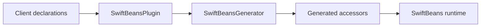
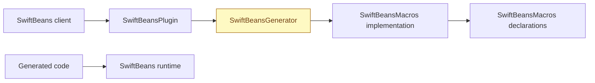
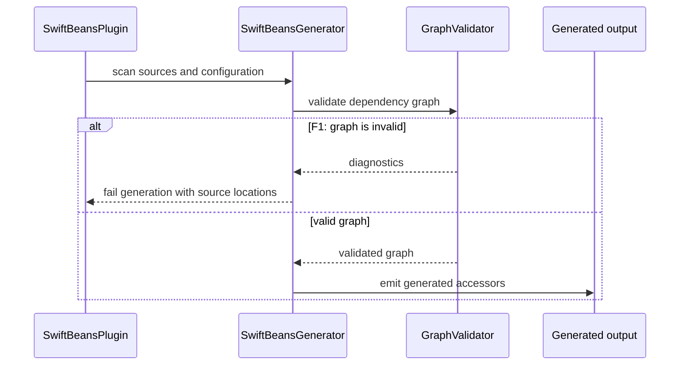

# <Feature name> — system design

- **Spec:** `specs/<feature>/SPEC.md`, written after this design is approved
- **Design approved:** <YYYY-MM-DD> (chat)

This template is for SwiftBeans package work. Keep only relevant sections; remove irrelevant sections instead of leaving
placeholders. Use real target, type, and macro names. A design describes responsibilities and dependencies, not every
implementation detail.

## Summary

<What changes for package clients, and why.>

## Public surface and generated-code flow

<Show how a client declaration/configuration flows through the plugin, generator, macros, and runtime as applicable.>

## Module seams

Show only the modules touched. Colour additions, changes, and removals; unchanged parts use the default style.

## Contracts and invariants

- **Public declarations:** <types, macros, functions, properties, access levels, and source compatibility>
- **Generated code:** <observable shape and compile-time assumptions>
- **Resolution/lifetime:** <registration, lookup, scopes, ownership, and teardown if relevant>
- **Concurrency:** <isolation, Sendable requirements, locking, and execution context if relevant>
- **Diagnostics/errors:** <trigger, severity, source location, and client-facing message if relevant>

## Main flow and failure paths

<Use a sequence diagram when control or data flow needs clarification. Label each failure branch F1, F2, … in order;
each branch must have a matching SPEC scenario.>

## Open questions

- <Questions the reviewer should decide at the design gate.>
