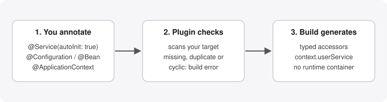

<p align="center">
	
</p>

<h1 align="center">SwiftBeans</h1>

<p align="center">Spring-style dependency injection for Swift, wired at <b>compile time</b>.</p>

<p align="center">
	<a href="https://github.com/illescasDaniel/SwiftBeans/actions/workflows/ci.yml"></a>
	<a href="https://github.com/illescasDaniel/SwiftBeans/releases"></a>
	<a href="Package.swift"></a>
	<a href="#installation"></a>
	<a href="Package.swift"></a>
	<a href="LICENSE"></a>
</p>

You annotate types and factories. A build tool plugin scans your target, checks the graph, and generates plain Swift accessors on your context. A missing, duplicate or cyclic dependency fails the build with a clickable `file:line:column` error. There is no runtime container and no `resolve(Type.self)`.



Text version: (1) you annotate types with `@Service`, `@Configuration`/`@Bean` and one `@ApplicationContext`; (2) the plugin scans the target and validates the graph, failing the build on a missing, duplicate or cyclic dependency; (3) the build generates typed accessors such as `context.userService`.

## Quick start

[Install the package and plugin](#installation), then annotate and use:

```swift
@ApplicationContext
final class AppContext {}

@Service(autoInit: true) // recommended: generates `init(apiClient:)` from the stored properties
final class UserService {
	private let apiClient: any APIClient
}

let context = AppContext()
let users = context.userService // generated, type-checked, no lookup
```

`APIClient` needs a provider too, for example a `@Bean` (see [Concepts](#concepts)). If it is missing, the build fails and tells you where.

Requirements: Swift 6.4 toolchain; iOS 18, macOS 15, tvOS 18, watchOS 11, Mac Catalyst 18. CI runs `swift test` plus the example app tests on macOS and an iOS Simulator build.

## Contents

- [Quick start](#quick-start)
- [Installation](#installation)
- [Concepts](#concepts)
- [Scopes](#scopes)
- [Binding to protocols](#binding-to-protocols)
- [Collections: every bean of a kind](#collections-every-bean-of-a-kind)
- [Auto-generated initializers](#auto-generated-initializers)
- [Choosing an initializer: `@Inject`](#choosing-an-initializer-inject)
- [Runtime arguments: `@Assisted`](#runtime-arguments-assisted)
- [Qualifiers: several beans of one type](#qualifiers-several-beans-of-one-type)
- [Factories: `(Item) -> T` and `() -> T`](#factories-item---t-and----t)
- [Child contexts: login lifetime](#child-contexts-login-lifetime)
- [Testing and Previews: `{Context}Protocol`](#testing-and-previews-contextprotocol)
- [Beans from local packages: `.swiftbeans.yml`](#beans-from-local-packages-swiftbeansyml)
- [Rules worth knowing](#rules-worth-knowing)
- [Example app](#example-app)
- [Development and tests](#development-and-tests)
- [Project docs](#project-docs)
- [License](#license)

## Installation

SwiftBeans is pre-1.0: any `0.x` minor release may break the API, so pin with `.upToNextMinor` rather than `from:`.

The package exports two products: the `SwiftBeans` library and the `SwiftBeansPlugin` build tool plugin. Attach the plugin to the target that declares your `@ApplicationContext`.

### Swift Package Manager

```swift
dependencies: [
	.package(url: "https://github.com/illescasDaniel/SwiftBeans", .upToNextMinor(from: "0.3.0")),
],
targets: [
	.target(
		name: "App",
		dependencies: [.product(name: "SwiftBeans", package: "SwiftBeans")],
		plugins: [.plugin(name: "SwiftBeansPlugin", package: "SwiftBeans")]
	),
]
```

### Xcode app project

1. Add the package and link the `SwiftBeans` library to the app target.
2. In the app target's **Build Phases → Run Build Tool Plug-ins**, add `SwiftBeansPlugin`.
3. Trust the plugin and macros when Xcode asks (on CI, pass `-skipPackagePluginValidation -skipMacroValidation` to `xcodebuild`).

The plugin writes `SwiftBeansGenerated.swift` into the build folder. You never edit or commit it.

Next to it the plugin writes `SwiftBeansGraph.md` (providers and dependencies as tables) and `SwiftBeansGraph.dot` (Graphviz: `dot -Tsvg SwiftBeansGraph.dot -o graph.svg`), a quick way to see what is wired to what. With SwiftPM they are under `.build/plugins/outputs/<package>/<target>/destination/SwiftBeansPlugin/`; with Xcode, in the target's plugin work folder inside DerivedData (search for `SwiftBeansGraph.md`). They are only written when generation succeeds.

## Concepts

| Annotation | On | Meaning |
|------------|----|---------|
| `@ApplicationContext` | a `class` | The root of the graph. Generated accessors are added to it as an extension. One per target. |
| `@Service` | a `class`, `struct` or `actor` | Register the type. Its initializer parameters are injected by type; `autoInit: true` generates that initializer from the stored properties. |
| `@Configuration` | an `enum`, `struct`, `class` or `actor` | Holds `@Bean` factories. |
| `@Bean` | a `static func` in a `@Configuration` | Register the return value. Use it for types you don't own (`URLSession`, third-party clients) or that need custom setup. |
| `@Inject` | an `init` | Pick the initializer the graph calls when a service has several. |
| `@Assisted` | an initializer or `@Bean` parameter, or a stored property of an `autoInit: true` service | A value the caller passes at creation time instead of the graph. |

```swift
import SwiftBeans

@Configuration
enum AppConfiguration {
	@Bean
	static func urlSession() -> URLSession { .shared }

	@Bean
	static func apiClient(urlSession: URLSession) -> any APIClient {
		DefaultAPIClient(urlSession: urlSession)
	}
}

@Service(autoInit: true)
final class UserService {
	private let apiClient: any APIClient // `autoInit: true` writes `init(apiClient:)` for you
}

@ApplicationContext
final class AppContext {}
```

Generated (simplified):

```swift
extension AppContext {
	var urlSession: URLSession {
		_swiftBeansRegistry.singleton(key: "urlSession") { AppConfiguration.urlSession() }
	}
	var apiClient: any APIClient {
		_swiftBeansRegistry.singleton(key: "apiClient") { AppConfiguration.apiClient(urlSession: self.urlSession) }
	}
	var userService: UserService {
		_swiftBeansRegistry.singleton(key: "userService") { UserService(apiClient: self.apiClient) }
	}
}
```

Accessor names come from the type: `UserService` → `userService`, `URLSession` → `urlSession`, `Outer.Inner` → `outerInner`, `[User]` → `userArray`, `[String: Int]` → `stringIntDictionary`.

Without `autoInit`, write the `init` yourself (`init(apiClient: any APIClient) { self.apiClient = apiClient }`); see [Auto-generated initializers](#auto-generated-initializers). Your types stay plain Swift: tests can call `UserService(apiClient: FakeAPIClient())` directly, without any context.

## Scopes

| Scope | Behavior |
|-------|----------|
| `.singleton` (default) | One instance per context instance, created on first access. Thread-safe: the factory runs at most once even under concurrent first access. |
| `.transient` | A new instance on every access. Good for view models. |

```swift
@Service(scope: .transient)
@MainActor @Observable
final class ItemListViewModel {
	init(fetchItems: FetchItemsUseCase) { … }
}
```

`scope:` must be a literal (`.singleton` / `.transient`), because the generator reads it at build time.

SwiftBeans does not force an isolation on your graph. Put `@MainActor` on the context (or use default main-actor isolation) for app code; leave it off for server or CLI code.

## Binding to protocols

Register an implementation under a protocol so consumers depend on the abstraction:

```swift
@Service(boundTo: ItemRepository.self)
final class JSONPlaceholderItemRepository: ItemRepository {
	init(httpClient: any HTTPClient) { … }
}

@Service
final class FetchItemsUseCase {
	init(repository: any ItemRepository) { … } // `any P` and `P` are the same key
}
```

A `@Bean` whose return type is a protocol (`-> any APIClient`) does the same.

## Collections: every bean of a kind

A parameter typed `[any P]` (or `[P]`) receives every bean that is a `P`, like Spring's `List<P>` injection. Useful for analytics trackers, HTTP interceptors and plugins:

```swift
@Service final class ConsoleTracker: AnalyticsTracker { init() { … } }
@Service final class FirebaseTracker: AnalyticsTracker { init() { … } }

@Service
final class Analytics {
	init(trackers: [any AnalyticsTracker]) { … }
}

// Generated
Analytics(trackers: [self.consoleTracker, self.firebaseTracker])
```

- A bean is a member when its key is `P` (`boundTo: P.self`, `-> any P`) or its type declares `: P` in a scanned declaration or extension (also through a superclass or sub-protocol). Conformance is matched by spelling.
- Members are listed by accessor name. Each keeps its own accessor and scope.
- A bean that provides `[P]` itself (`@Bean static func trackers() -> [any AnalyticsTracker]`) wins over the members, and `@Bean static func tags() -> [String]` stays an ordinary bean.
- No members: `[any P]` gets `[]`; `[P]` without `any` (e.g. `[String]`) is a missing dependency. A defaulted collection keeps its default.
- Assisted beans are never members, and a bean is never a member of its own collection (so a composite `@Service(boundTo: P.self)` can wrap all the others).

## Auto-generated initializers

`@Service(autoInit: true)` generates the memberwise `init` for a `class`, `struct` or `actor`, so you only declare the stored properties. The generated initializer is what the graph calls, and tests can call it directly with the property names as labels.

```swift
@Service(autoInit: true)
@MainActor @Observable
final class ItemDetailViewModel {
	private let repository: any ItemRepository
	@Assisted private(set) var item: Item
	@Qualifier("snakeCase") private let decoder: JSONDecoder
	private(set) var state: LoadState = .idle // has a value: not a parameter
}
// init(repository: any ItemRepository, @Assisted item: Item, @Qualifier("snakeCase") decoder: JSONDecoder)
```

- Included: instance stored `let` and `var` properties without an initial value, in declaration order.
- Skipped: `static`/`class`, `lazy`, computed properties, and any property that already has a value (`let x = 1`, `var y = 0`).
- An optional `var` without a value becomes a parameter with a `= nil` default. An optional `let` without a value is a plain parameter.
- The initializer is `internal`, or `public`/`package` when the type is; `private` properties still become parameters.
- `@Assisted` and `@Qualifier("name")` go on the property and are moved onto the generated parameter.
- An optional `var x: T?` without a value becomes an optional injected dependency. Give private optional state an initial value (`private var task: Task<Void, Never>? = nil`) to keep it out of the init.
- A function-typed property gets `@escaping` automatically, so `private let makeItem: @MainActor () -> Item` works as a factory. Spell the closure type out: a `typealias` for a closure type is not recognized, so the generated init fails to compile with "assigning non-escaping parameter 'make' to an '@escaping' closure". Use the full type or write the `init` yourself.
- It is an error to combine `autoInit: true` with a hand-written `init`, with an attribute on a stored property other than `@ObservationIgnored`, `@available`, `@Assisted` and `@Qualifier`, or with destructuring patterns and untyped properties.
- Subclasses work when the superclass has a zero-argument designated `init` (Swift calls `super.init()` implicitly). Otherwise write the `init` by hand.

Write the `init` by hand when it does more than store parameters: derives values from them, starts work, supplies a default non-optional parameter value, has several initializers selected with `@Inject`, or needs property-wrapper storage.

## Choosing an initializer: `@Inject`

With exactly one eligible initializer there is nothing to do. With several, mark the one the graph calls:

```swift
@Service
final class TagSummary {
	@Inject
	init(tagCounts: [String: Int]) { … }

	convenience init(tags: [String]) { … } // for tests and manual use
}
```

A parameter with a default value is an optional dependency: it is injected if the graph provides that type, and left to its default otherwise.

## Runtime arguments: `@Assisted`

Some values only exist where an object is created: the selected item, a navigation argument, a search query. Mark those parameters `@Assisted` and the context exposes a **method** instead of a property. The graph fills in the rest.

```swift
@Service
@MainActor @Observable
final class ItemDetailViewModel {
	init(repository: any ItemRepository, @Assisted item: Item) { … }
}

// Generated
extension AppContext {
	func itemDetailViewModel(item: Item) -> ItemDetailViewModel {
		ItemDetailViewModel(repository: self.itemRepository, item: item)
	}
}

// Call site
let viewModel = context.itemDetailViewModel(item: selectedItem)
```

- `@Assisted` is a marker property wrapper: callers pass a plain `Item` and the initializer body sees a plain `Item`.
- Labels and order are kept (`@Assisted _ id: Int` → `itemDetailViewModel(_ id: Int)`).
- An assisted provider is always transient. An explicit `scope: .singleton` is a build error.
- Other beans cannot inject an assisted type (the graph has no runtime arguments to give); the error names the method to call, or inject a [factory](#factories-item---t-and----t) instead.
- Default values, `inout` and variadic `@Assisted` parameters are not supported yet.

## Qualifiers: several beans of one type

When you need two differently configured beans of the same type, name them and ask with `@Qualifier`:

```swift
@Configuration
enum Coding {
	@Bean
	static func decoder() -> JSONDecoder { JSONDecoder() }

	@Bean(named: "snakeCase")
	static func snakeCaseDecoder() -> JSONDecoder {
		let decoder = JSONDecoder()
		decoder.keyDecodingStrategy = .convertFromSnakeCase
		return decoder
	}
}

@Service
final class ItemParser {
	init(@Qualifier("snakeCase") decoder: JSONDecoder, fallback: JSONDecoder) { … }
}

// Generated accessors: jsonDecoder, snakeCaseJSONDecoder
```

The key is `(type, name)`, so `snakeCase` on `JSONDecoder` and on `JSONEncoder` are unrelated. An unqualified parameter never silently picks a named bean. See [`specs/qualifiers/SPEC.md`](specs/qualifiers/SPEC.md).

## Factories: `(Item) -> T` and `() -> T`

A bean can take a function instead of a value, so it can create objects later or repeatedly without holding the context.

```swift
@Service(scope: .transient)
final class Coordinator {
	init(
		makeDetail: @escaping (Item) -> ItemDetailViewModel, // assisted provider
		makeList: @escaping () -> ItemListViewModel          // any other provider
	) { … }
}

// Generated
Coordinator(makeDetail: { self.itemDetailViewModel(item: $0) }, makeList: { self.itemListViewModel })
```

- `(A, B) -> T` is wired to `T`'s assisted method when `T`'s `@Assisted` parameter types are `A, B` in order. Labels on the function type are ignored (Swift erases them); a mismatch is a `factory.unresolved` error naming the expected signature.
- `() -> T` re-reads `T`'s accessor on each call: a singleton returns the same instance, a transient a new one.
- Factories are lazy, so they **break cycles**: `A` taking `() -> B` while `B` takes `A` is fine.
- Function types work only as dependency parameters, not as bean return types or `boundTo:` keys.
- The closure captures the context strongly: keep factories in transient beans (a coordinator), not singletons, if the context must be freed.
- Factories resolve against the **unqualified** provider of the return type (see qualifiers above).

## Child contexts: login lifetime

A child graph owns dependencies for one login while sharing app-lifetime repositories and infrastructure from its parent:

```swift
@MainActor
@ChildContext(of: AppContext.self, teardown: .managed)
final class LoggedInContext {
	@ContextInput let credentials: SessionCredentials
}

@MainActor
@Service(in: LoggedInContext.self)
final class UserRepository: ContextCleanup {
	init(credentials: SessionCredentials, catalog: any ItemRepository) { … }

	func close() async {
		// Stop owned session work and await its completion.
	}
}

let child = LoggedInContext(parent: appContext, credentials: credentials)
let repository = child.userRepository
await child.close()
```

`@ContextInput` is one stored instance `let` with an explicit nonoptional type and no default. The generated initializer takes `parent:` then inputs in declaration order. The parent is typed as its generated protocol, so a fake parent works too. Each child protocol exposes its own beans and input properties. Children see parent beans; parents and siblings cannot see child beans. Duplicate keys across a parent/child chain are errors. Providers default to the root; `@Configuration(in:)` can supply a default owner with per-`@Bean(in:)` overrides.

Omitting `teardown:` selects `.arc`: releasing the child releases its cache when no other owner retains it. `.managed` requires explicit `@MainActor` and adds nonthrowing `close() async`. Awaiting close automatically invokes `ContextCleanup` on instantiated child singleton objects, once per object identity in reverse creation order, then releases the cache. It never constructs unused beans for cleanup or closes parent beans, inputs, transients or assisted instances. Repeated close callers await the same operation; cancellation of a waiter does not cancel cleanup.

Generated resolution and retained child factories trap with a named precondition once closing starts. Stored inputs remain readable. Objects retained by an outgoing view/model can outlive close; participating services define their own behavior after shutdown. ARC cannot force their deallocation, and deinit does not launch asynchronous cleanup. The app must await close at logout or authentication expiry. Cleanup uses already-held dependencies and must not recursively await the same context's close or resolve new beans through it.

The example's app-owned `AppSession` owns a `LoggedInFlow` containing the context and a transient `LoggedInCoordinator`. The app composes `AppCoordinator` separately with a login-model factory and injected sign-in action; root presentation observes the session, and signed-in UI receives logout/expiry callbacks. That child coordinator keeps the existing screen-factory / `build(_:)` pattern, and views own their models through `@State`. Logout removes the signed-in tree and awaits flow cleanup before allowing another login. Factory closures retain their context, so caching a coordinator that retains those factories as a singleton in that context can create a cycle. Local-package providers remain app-owned; child graphs are declared in the target that owns the root. Root inputs, child-of-child graphs and parent overrides are deferred.

## Testing and Previews: `{Context}Protocol`

For each context the plugin also generates a protocol with the same accessors and methods, and conforms the context to it:

```swift
// Generated
protocol AppContextProtocol: AnyObject {
	var itemRepository: any ItemRepository { get }
	var itemListViewModel: ItemListViewModel { get }
	func itemDetailViewModel(item: Item) -> ItemDetailViewModel
	// …
}
extension AppContext: AppContextProtocol {}
```

Type the code that creates screens (a coordinator, a factory) against `any AppContextProtocol`, and hand-write a fake for Previews and tests:

```swift
#if DEBUG
@MainActor
final class FakeAppContext: AppContextProtocol {
	let itemRepository: any ItemRepository
	// …
	var itemListViewModel: ItemListViewModel {
		ItemListViewModel(fetchItems: FetchItemsUseCase(repository: itemRepository))
	}
	func itemDetailViewModel(item: Item) -> ItemDetailViewModel {
		ItemDetailViewModel(repository: itemRepository, item: item)
	}

	init(itemRepository: (any ItemRepository)? = nil) {
		self.itemRepository = itemRepository ?? InMemoryItemRepository()
	}
}
#endif

#Preview {
	let context = FakeAppContext()
	ItemListView(viewModel: context.itemListViewModel)
}
```

When the graph gains a bean, the fake stops compiling until you add it, so it can't silently drift.

Keep the context out of views: views receive their view model; the coordinator holds the context and builds screens.

## Beans from local packages: `.swiftbeans.yml`

The plugin scans exactly the files the build system compiles for the target. To let types from local packages join the graph, list them in `.swiftbeans.yml` at the package root (SPM) or next to the `.xcodeproj` (Xcode):

```yaml
local_packages:
  - path: Packages/GreetingKit   # relative to this file
    targets:
      - GreetingKitLive
```

- Every `.swift` file under `Packages/GreetingKit/Sources/GreetingKitLive/` is scanned, and the generated file imports `GreetingKitLive` for you, so the app can depend on just the protocol module.
- Providers in local packages must be `public` (type, selected initializer, or `public static` `@Bean` in a `public` configuration).
- A wrong path, missing target folder or unsupported YAML fails the build with an error pointing at the entry.
- Types from other dependencies (remote packages, SDKs) are registered with `@Bean`.
- Adding a file under a listed target (or creating/editing `.swiftbeans.yml`) regenerates the wiring on the next build; no clean build needed. Edge case: files added to a folder that was itself created after the last plugin planning may need a re-plan (edit any file in the app target).

## Rules worth knowing

- Every annotated declaration is wired or reported; nothing is skipped silently. All errors from one build are reported together, in a stable order.
- `@Bean` methods are `static`, have a return type, no generics, and may not `throw` or be `async`; the same goes for selected initializers.
- Annotated declarations inside `#if` blocks are a build error (the generator can't know which branch compiles). `#if` inside a function body is fine.
- Unsupported key types: optionals, tuples, functions (except as factory parameters), `some P`, metatypes, `any A & B`, generic parameters. Wrap them in a named type or provide a protocol.
- Keys match by spelling after normalization: `[String: Int]` ≡ `Dictionary<String, Int>`, `any P` ≡ `P`, but a typealias and its underlying type are different keys.
- Generic `@Service` types and property injection are unsupported. Child contexts support one level in the root target; root context inputs and nested child graphs are deferred.

## Example app

[`Examples/SwiftBeansExample`](Examples/SwiftBeansExample) is a multiplatform SwiftUI app (iOS + macOS) that uses every feature above: `@Configuration` beans for an HTTP client, a protocol-bound repository, transient view models, `@Inject`, `@Assisted`, qualifiers (`@Bean(named:)` / `@Service(named:)` / `@Qualifier`, including two `JSONDecoder`s), collection injection (`[any FeatureNote]`), an explicit named `[any FeatureNote]` array bean whose generated accessor preserves nested `any`, factories on `LoggedInCoordinator`, a local package via `.swiftbeans.yml`, and `FakeAppContext` / `FakeLoggedInContext` for Previews and tests. A local demo login creates a managed child, the User tab receives its session repository through a factory-built model, and logout/expiry await cleanup while app repositories remain alive. Debug builds use an offline fake HTTP handler; Release builds use `URLSession.shared`. The features screen shows the live wiring.

```bash
cd Examples/SwiftBeansExample && xcodebuild test -project SwiftBeansExample.xcodeproj -scheme SwiftBeansExample -destination 'platform=macOS' -skipPackagePluginValidation -skipMacroValidation
```

## Development and tests

```bash
swift test
```

Example app tests: see the command under [Example app](#example-app). The project uses spec-driven development: [AGENTS.md](AGENTS.md) describes the phase gates.

## Project docs

- [Docs index](docs/INDEX.md): one line per doc, generated.
- [SPEC](specs/compile-time-di/SPEC.md): behavior, generator rules and acceptance scenarios.
- [ARCHITECTURE](specs/compile-time-di/ARCHITECTURE.md): module seams, generator pipeline, generated code shape.
- [Auto-init spec](specs/service-auto-init/SPEC.md): `@Service(autoInit: true)`.
- [CHANGELOG](CHANGELOG.md): what changed per release.
- [AGENTS.md](AGENTS.md): how this repo is developed (spec-driven, phase gates).

## License

MIT. See [LICENSE](LICENSE).
