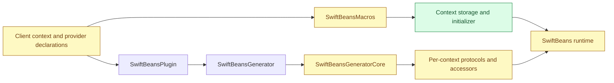
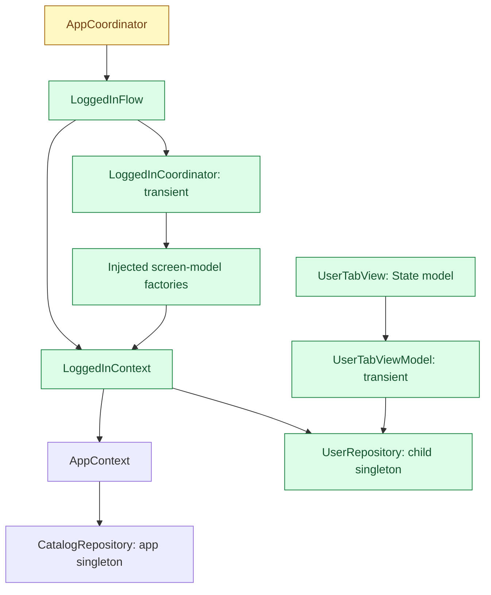

# Child contexts — system design

- **Status:** design, Phase 1 decisions, spec and architecture approved in chat on 2026-10-25; implementation and verification follow those contracts.
- **Spec:** `specs/child-contexts/SPEC.md` is the approved revision of the historical ARC-only draft.
- **Architecture:** `specs/child-contexts/ARCHITECTURE.md` contains the approved Phase 2 contracts and compiler-checked snapshots (approved 2026-10-25).
- **Design approved:** 2026-10-25 (user: "approved").

## Summary

Add compile-time child dependency graphs for a login lifetime. A child receives runtime inputs and can use its own providers and its parent's providers. The app owns one flow per login and ends it on logout or authentication expiry.

Preserve the example's factory-injected coordinators, `build(_:)` navigation and view-owned `@State` models. Introduce an application-owned `LoggedInFlow` containing a child context and a transient `LoggedInCoordinator`.

ARC remains the default disposal mechanism. Optional managed teardown automatically invokes cleanup for participating, instantiated child singletons when the app calls `await flow.close()`. Escaped references may delay deallocation; cleanup and deallocation are separate operations.

## Public surface and generated-code flow

Proposed client declarations; exact public contracts belong to Phase 2:

```swift
@MainActor
@ChildContext(of: AppContext.self, teardown: .managed)
final class LoggedInContext {
	@ContextInput let credentials: SessionCredentials
}

@MainActor
@Service(in: LoggedInContext.self, scope: .transient)
final class UserTabViewModel {
	init(repository: any UserRepository) { /* ... */ }
}
```

- `@ChildContext(of:)` names a parent context in the same target. Initially support one level beneath the single `@ApplicationContext` root.
- `@ContextInput let` properties become generated initializer parameters after `parent:` and providers in the child. No defaults, optional inputs, custom initializers or input named `parent` initially.
- Optional `in:` on `@Service`, `@Bean` and `@Configuration` selects the owner. Omitted ownership continues to mean root; individual beans may override their configuration's default.
- Children retain `any ParentContextProtocol` strongly. Their generated protocols expose own keys and inputs, with no parent accessor re-export.
- Each context has its own singleton cache. Generated dependencies call own accessors or parent-protocol accessors according to compile-time resolution.
- `teardown:` defaults to `.arc`; optional `.managed` adds `close() async` to the concrete child and its generated protocol.



Macros and the generator examine the same source declarations independently; generator execution does not invoke macro expansion. The plugin remains responsible for source/configuration inputs and invoking the generator.

## Module seams

| Module | Proposed responsibility |
|---|---|
| `SwiftBeans` | Macro declarations, teardown policy and optional cleanup protocol; per-context lifecycle support beside existing singleton registry semantics |
| `SwiftBeansMacros` | Child-context members and initializer; local input, ownership and isolation diagnostics |
| `SwiftBeansSyntaxRules` | Shared single-declaration rules for child shapes, inputs and ownership literals |
| `SwiftBeansGeneratorCore` | Context ownership and visible-key resolution; diagnostics; isolated per-context protocols/accessors; factory and collection delegation; managed cleanup integration |
| `SwiftBeansGenerator` / `SwiftBeansPlugin` | Preserve existing invocation and source discovery; no new product or runtime lookup service |
| Example app | Flow/coordinator composition, login state, cancellation ownership, logout and authentication-expiry routing |

The lifecycle state, cleanup records and cache-release interface must be placed explicitly in Phase 2. Keep root registry once-only guarantees intact; managed support must not silently change existing root graphs.

## Resolution and compatibility

- Visibility is child → parent. Parent providers cannot use child keys; siblings are isolated. Parent providers always resolve their own dependencies in the parent graph.
- Duplicate keys across a parent/child chain are errors; distinct siblings can own the same key. No shadowing or overrides initially.
- Shipped qualifier semantics apply to visible keys. Deferred and assisted factories resolve their visible unqualified return provider. Collections gather visible members while resolving each through its owner; parent collections exclude child members.
- Keep factory capture semantics: factories may strongly retain their context. A context-cached singleton retaining such a factory can form a cycle. The example coordinator must be transient; this design does not eliminate arbitrary application retain cycles.
- Providers in local packages cannot name app-owned child contexts. Child contexts live in the same target as their root.
- Graphs with no child declarations or ownership changes preserve generated output and source behavior. Preserve Swift 6.4+ and the package's existing platform support.

## Managed teardown proposal

The proposed cleanup marker is an `@MainActor`, class-bound `ContextCleanup` protocol with a nonthrowing `func close() async` requirement. Names remain subject to approval.

1. Managed children initially require explicit `@MainActor`. Generated initializer, protocol, accessors, factory signatures and cleanup state must preserve isolation. Phase 2 must demonstrate strict-concurrency-safe signatures, including compatible fake parents, without unsafe sendability promises. General managed actor support is deferred; ARC-only contexts retain their existing concurrency model.
2. Managed contexts transition `open → closing → closed`. On first close, enter closing before awaiting cleanup. Repeated callers await the same completion; cancellation of a waiting caller does not cancel shared cleanup.
3. Once closing begins, generated accessors, assisted methods and retained child-rooted factories fail a documented context-naming precondition. They cannot return cached objects or construct new ones. Existing accessors remain nonthrowing. Stored inputs remain readable.
4. Enroll only successfully instantiated, child-owned singleton objects conforming to `ContextCleanup`. Never construct an unresolved provider for cleanup. Exclude parent objects, inputs and transient/assisted instances; their owners handle their lifecycles.
5. Close sequentially in reverse successful creation order, deduplicated by object identity within the child. Deferred factories mean this is not a promise of reverse dependency order. Separate children must not share cleanup ownership of one object; place such shared objects in the parent.
6. Await callbacks, release singleton cache and cleanup records, then mark closed. Retain the parent and input properties until context deallocation. Callback implementations handle their own recoverable failures; no implicit timeout is imposed.
7. Cleanup must use already-held dependencies and must not resolve from the closing context or recursively await that context's close. A callback that never returns prevents completion.
8. Participating services define their own inactive state and cancellation behavior. Cleanup can run while a view still retains a service; SwiftBeans cannot intercept arbitrary service methods or force that object to deallocate.
9. No async deinit fallback: releasing an unclosed context still performs ARC release, but does not promise callbacks. The application explicitly ends the flow once; the managed context automatically dispatches the enrolled cleanup.

This mode deliberately starts with a narrower actor model to make the async close/resolution boundary well defined. Approving that restriction and the resolution precondition is a design choice, not an assumption already agreed in chat.

## Example app composition



`LoggedInFlow` is application code with a unique presentation identity, a child context, a child coordinator and an async close operation delegating to the context. The child registry does not cache its transient coordinator; releasing the flow can therefore release the coordinator, its factory closures and the child.

At the app entry point, assemble the root coordinator with login-model factories and a manually supplied `(SessionCredentials) -> LoggedInFlow` factory. This closure creates `LoggedInContext(parent: app, credentials:)` and its flow. Generated child factories and context injection are unnecessary for this first example.

`AppRootView` presents login until authentication succeeds. It then presents a navigation/tab subtree keyed by the new flow identity, with `LoggedInCoordinator` in the environment. Navigation uses `coordinator.build(.itemList)` and `coordinator.build(.user)`; those builders call injected factories, exactly as the current example does. Views own models through `@State`; models receive repositories or use cases. Contexts stay at the composition boundary.

App-owned repositories hold data/infrastructure whose lifetime spans logins, such as a catalog repository. The child `UserRepository` and session work hold the current user's dependencies. An item-list model in the child can use an app repository; its user-tab counterpart uses the child repository.

## Main flow and failure paths

1. Launch creates the app graph and login presentation. No logged-in flow or child services exist yet.
2. Successful authentication creates a fresh child, coordinator and flow identity. Authentication failure remains in the login flow.
3. Switching tabs or navigating preserves the flow. SwiftUI disappearance is not a session-ending event.
4. Logout or authentication expiry invalidates pending login attempts, marks session ending, removes the active flow from presentation and retains it locally while awaiting close. Another login is gated until cleanup completes. Duplicate logout requests do not start another cleanup.
5. Close stops participating session work and clears owned cache references. After outgoing UI and tasks release their references, session objects deallocate. The app context and app repositories remain usable.
6. The next login creates a new identity, navigation state and user repository. Late results from an obsolete login attempt cannot restore an ended flow. Persistent credential deletion/revocation belongs to authentication code.

| Failure | Proposed handling; requires a matching Phase 1 scenario |
|---|---|
| F1: invalid/unknown/cyclic parent, missing root, unsupported context shape | Positioned build error; no usable generated graph |
| F2: missing dependency, sibling/descendant access, duplicate key, accessor collision or graph cycle | Positioned graph diagnostic naming the relevant context(s) |
| F3: invalid input, ownership literal, local-package child owner, initializer/lifecycle name collision | Positioned macro/generator diagnostic |
| F4: managed child with unsupported isolation | Positioned diagnostic; strict-concurrency generated-source compile coverage |
| F5: generated resolution during/after close, including escaped factories | Documented runtime precondition; no new materialization |
| F6: repeated close or cancelled waiter | One shared close operation; no duplicate callbacks |
| F7: escaped service reference | Cleanup still runs; service defines later behavior; eventual ARC deallocation |
| F8: managed context dropped without close | ARC release only; no async cleanup guarantee |
| F9: cleanup stalls or violates no-recursive-close contract | No completion/timeout guarantee; document callback obligations |
| F10: login failure, duplicate logout, or stale authentication completion | Login remains or returns to presentation; no stale flow creation or duplicate teardown |

## Resource and trust boundaries for spec review

Resolution remains generated and direct. No runtime registration, live context tree, global locator or remote input is added. The generator validates source/configuration at the existing plugin boundary. Managed lifecycle bookkeeping scales with instantiated child singletons and enrolled cleanup objects, not every declared provider. Close visits enrolled objects sequentially; wall-clock cleanup duration is controlled by callbacks.

Phase 1 must set an explicit build-time/generated-code budget or document why an initial quantitative threshold is unnecessary. Generated graph diagnostics and graph-dump ownership presentation must be reconciled with the shipped features when defining observable output. No source behavior changes for existing root-only clients are intended.

## Delivery and approved direction

- **A1:** Single-level child graphs, inputs, ownership, visibility diagnostics and compatibility with existing factories, qualifiers and collections.
- **A2:** Managed teardown and the coordinator-owned login/logout example, including user tab, shared app repository, cancellation and release verification. A1 alone does not complete this development.
- **Later:** Root context inputs, generated child factories, nested children, overrides, lifecycle annotations and broader managed actor support.

The user approved these proposals at the design gate on 2026-10-25:

1. Keep the root coordinator as flow owner and use a transient child coordinator with existing factory/build conventions.
2. Add `.managed` alongside default `.arc`, with automatically dispatched `ContextCleanup` callbacks when flow close is awaited.
3. Initially restrict managed children to explicit `@MainActor` and make generated resolution after closing a precondition failure.
4. Limit automatic cleanup to instantiated child singletons, with identity deduplication and reverse creation order; retain the stated escaped-reference limits.
5. Deliver A1 and A2 as the initial feature. After design approval, revise the historical spec for a separate approval, then write architecture/contracts for their own approval.

## Phase 1 decision review

The first, second, fourth and fifth decisions below carry forward the approved design. The user confirmed the remaining performance-budget proposal with “cool” on 2026-10-25. All five decisions are resolved for spec drafting; the revised spec requires its own approval.

| Required decision | Answer and approval evidence |
|---|---|
| Success criteria | Deliver A1 child graphs and A2 managed cleanup plus the login/coordinator example. Verify context-local singleton identity, parent sharing, cleanup once, fresh login state and eventual release with no external owners. Approved design, 2026-10-25. |
| Failure handling | Positioned diagnostics for invalid graphs/declarations/isolation; precondition for generated resolution after closing begins; shared idempotent cleanup; callbacks handle recoverable failures; no implicit cleanup timeout. Approved design, 2026-10-25. |
| Performance and resource budget | Preserve byte-identical root-only generated output; no additional whole-source scan per child; lifecycle tracking proportional to instantiated child singletons and cleanup work proportional to enrolled objects. No initial absolute milliseconds/graph-size cap because the package has no agreed benchmark baseline. Callback latency is app-controlled and excluded from a fixed close-time budget. Record structural checks and representative graph comparisons in the architecture/test plan. Approved in chat, 2026-10-25. |
| Trust boundary | Source declarations and existing local configuration/package paths enter through current plugin/scanner validation. No remote inputs, runtime registration or service locator added. Invalid declarations fail generation. Approved design, 2026-10-25. |
| Compatibility and rollout | Preserve root-only clients/output, Swift 6.4+ and existing platform support. ARC remains default. New child graphs use explicit ownership; managed mode initially requires MainActor. A1/A2 together complete the requested feature; broader support stays deferred. Approved design, 2026-10-25. |
