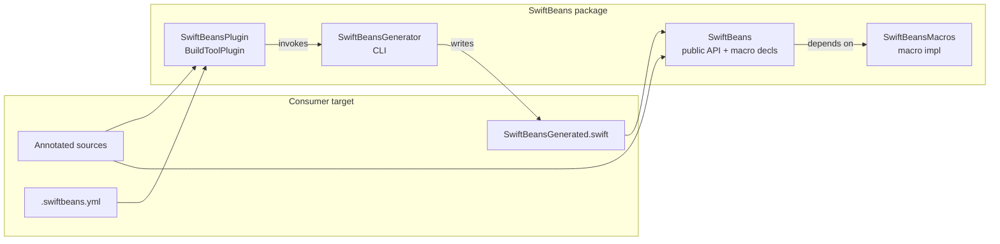

# Architecture: Compile-Time Spring-Style DI

Phase 2 contracts for [`SPEC.md`](SPEC.md). **Approved 2026-10-14.**

## Module seams



| Target | Kind | Responsibility |
|--------|------|----------------|
| `SwiftBeans` | library product | Public types (`BeanScope`), macro *declarations* (`#externalMacro`), `SwiftBeansRegistry` |
| `SwiftBeansMacros` | `.macro` | Expand attached macros: local validation + minimal surface (no cross-file discovery) |
| `SwiftBeansGenerator` | executable | Parse the Swift files it is given; build IR graph; emit `SwiftBeansGenerated.swift`; emit diagnostics on failure. **Does not read `.swiftbeans.yml` or search for files.** |
| `SwiftBeansPlugin` | build tool plugin | Own the scan set: read the build system's file list and `.swiftbeans.yml`, resolve local package sources, declare all of them as inputs, invoke the generator with the explicit file list |
| `SwiftBeansGeneratorCore` | internal library (tests + generator) | Graph IR, parser, validator, codegen, and the scan-set resolver source of truth (see [Scan-set resolution](#scan-set-resolution)) |
| `SwiftBeansTests` | tests | BDD scenarios against fixtures that apply the plugin (Phase 3+) |
| `SwiftBeansMacrosTests` | tests | Macro expansion unit tests via SwiftSyntax |

Consumers depend on product `SwiftBeans` and attach plugin `SwiftBeansPlugin` to the target that owns `@ApplicationContext`.

## Division of labor: macros vs generator

| Concern | Owner | Why |
|---------|-------|-----|
| Attribute is valid Swift | Macros (`@ApplicationContext`, `@Configuration`, `@Bean`, `@Service`) | Compiler must recognize attributes |
| `@Bean` is `static` | Macro diagnostic on `@Bean` | Local to the declaration |
| Discover all `@Service` / `@Bean` / `@Configuration` / `@ApplicationContext` across files & YAML packages | **Generator** | Macros cannot see other files |
| Missing / duplicate / cycle checks | **Generator** | Needs full graph IR |
| Emit accessors + singleton storage on the context type | **Generator** → `SwiftBeansGenerated.swift` | Cross-cutting; written as a normal `extension` on the user’s context type |
| Emit `{ContextTypeName}Protocol` + `extension Context: Protocol` | **Generator** → same file | Testable / Preview seam; same getters as accessors; fakes are user-owned |
| Optional peer helpers on a single type | Macros | Keep expansions small; prefer generator for graph output |

Macros are **not** the discovery engine. They are the public attribute API plus local checks. The generator is the Spring “component scan.”

## Public API contracts (library)

### `BeanScope`

```swift
public enum BeanScope: String, Sendable, Codable {
	case singleton
	case transient
}
```

Default when omitted on `@Service` / `@Bean`: `.singleton`.

### Scan config — file `.swiftbeans.yml`

Read **only** from the scan root: `PluginContext.package.directoryURL` (SPM) or `XcodePluginContext.xcodeProject.directoryURL` (Xcode, the folder containing the `.xcodeproj`). No upward search by the plugin or the generator.

```yaml
# .swiftbeans.yml
local_packages:
  - path: Packages/Networking
    targets:
      - Networking
```

Model (Foundation-only; lives with the resolver, **not** in the `SwiftBeans` runtime library, which consumers link into their apps):

```swift
struct SwiftBeansScanConfiguration: Equatable, Sendable {
	var localPackages: [LocalPackage]

	struct LocalPackage: Equatable, Sendable {
		var path: String
		var targets: [String]
		var line: Int // 1-based line of the `- path:` entry, for diagnostics
	}
}
```

YAML keys use `local_packages` / `path` / `targets`. Accepted syntax: block lists, optional single or double quotes around scalars, `#` comments outside quotes, `local_packages: []`. Anything else is a `ScanConfigurationError` with a line number.

Empty or missing file ⇒ scan only the plugin-attached target’s sources.

`public struct SwiftBeansScanConfiguration` is **removed** from the `SwiftBeans` library (pre-1.0, no published release). It was never used at runtime.

### Macro declaration surface (signatures)

Exact `#externalMacro` module names follow Package layout; semantics:

```swift
@attached(member, names: arbitrary) // storage hooks if needed; accessors primarily from generator
public macro ApplicationContext() = #externalMacro(...)

@attached(extension, conformances: /* none required in v1 */)
public macro Configuration() = #externalMacro(...)

@attached(peer) // or memberAttribute — validates static factory
public macro Bean(scope: BeanScope = .singleton) = #externalMacro(...)

@attached(peer) // attribute-only; optional diagnostic if no suitable init
public macro Service(
	boundTo: Any.Type? = nil,
	scope: BeanScope = .singleton
) = #externalMacro(...)
```

Phase 4 may simplify roles (e.g. marker macros that expand to `()`-empty) if the generator owns all codegen; the **names and parameters** above are the contract.

### Injectable key

v1 key = **fully qualified type name** of the provided type (protocol if `boundTo:` / protocol return type; else concrete type). No named qualifiers in v1.

## Generator IR (internal)

Not a public product API; documented for implementers:

```
ScanResult
  contexts: [ContextDecl]          // @ApplicationContext types (expect exactly one per graph / target in v1)
  configurations: [ConfigDecl]   // @Configuration types
  beans: [BeanProvider]          // static @Bean funcs → providedType, paramTypes, scope, source
  services: [ServiceProvider]    // @Service types → providedType (or boundTo), initParams, scope, source

Graph
  nodes: providers by InjectableKey
  edges: dependency → provider
  validate: missing | duplicate | cycle
```

v1 assumes **one** `@ApplicationContext` in the effective scan set. Multiple contexts → generator diagnostic (subcontexts later).

## Generated code shape

For `@ApplicationContext final class AppContext` and providers `UserService` (singleton), `Validator` (transient):

```swift
// SwiftBeansGenerated.swift (illustrative)
import SwiftBeans

extension AppContext {
	var userService: UserService {
		_swiftBeansRegistry.singleton(key: "UserService") {
			UserService(apiClient: self.apiClient)
		}
	}

	var validator: Validator {
		Validator(/* deps via self.* */)
	}
}
```

`SwiftBeansRegistry.singleton` runs `create` **outside** its lock so nested singleton factories (e.g. `UserService` → `apiClient`) do not re-enter a non-recursive lock.

Exact storage embedding (member macro property vs generated stored property) is an implementation detail; **observable contract** is:

- Camel-cased accessor per provided key (e.g. `userService` for `UserService`)
- Singleton: same instance for the lifetime of the context instance
- Transient: new instance per accessor call
- Construction calls `@Bean` static methods or `@Service` initializers with dependencies taken from other accessors

## Concurrency (v1 decision)

| Choice | Decision |
|--------|----------|
| Default isolation | **None forced** — users may add `@MainActor` to their context type |
| Singleton slots | **`SwiftBeansRegistry`** (`NSLock` + dictionary; create-outside-lock for nested deps) |
| Context type | Prefer `final class` so identity/lifetime match Spring-ish singleton-per-context |
| Sendable | Generated storage is Sendable-safe; user services need not be `Sendable` if the context is used from one actor — document that cross-actor sharing of non-Sendable beans is the user’s responsibility |

Rationale: a library package must work off the main actor and on Linux CI; forcing `@MainActor` on all graphs would hurt server/CLI use.

## Plugin invocation contract

Revised 2026-10-15 for SPEC → *Source discovery*.

### Responsibilities

| Step | Owner |
|------|-------|
| List target sources | Plugin — SPM: `SourceModuleTarget.sourceFiles(withSuffix: "swift")`; Xcode: `XcodeTarget.inputFiles` filtered to `.source` + `.swift` |
| Locate `.swiftbeans.yml` | Plugin — scan root only (see above) |
| Parse config + resolve local package sources | Plugin, via the shared resolver |
| Declare build inputs | Plugin — target sources ∪ local package sources ∪ config file (when present) |
| Parse sources, validate graph, write output | Generator |

No folder walking of the target, no source-root inference, no file-name markers. `expandedSwiftSources`, `inferSourceRoot`, `findConfig` (plugin) and `findConfiguration` / `--config` (generator) are deleted.

**Verified 2026-10-15 (Xcode 27.0, 27A266a):** for the example app's `PBXFileSystemSynchronizedRootGroup`, `XcodeTarget.inputFiles` lists every Swift file in nested subfolders (`Data/`, `DI/`, `Domain/`, `Navigation/`, `Presentation/`) as `.source`, and `xcodeProject.directoryURL` is `Examples/SwiftBeansExample`. The old recursive rescan is not needed. (The old heuristic only ever ran because `inputFiles.first` sat in a subfolder.)

### Generator CLI

```
SwiftBeansGenerator --output <file> <source.swift>...
```

- Sources are taken as given; the generator de-duplicates by resolved path and sorts them (SPEC rule 6).
- Exit code ≠ 0 + `error: …` on stderr ⇒ build failure (missing / duplicate / cycle).

### Scan-set resolution

A single Foundation-only Swift file, `ScanSetResolution.swift`, holds:

```swift
enum ScanConfigurationParser {
	static func parse(_ text: String) throws(ScanConfigurationError) -> SwiftBeansScanConfiguration
}

enum ScanSetResolver {
	/// Resolves `local_packages` to sorted, de-duplicated `.swift` files.
	/// Paths are relative to `configDirectory`, standardized and symlink-resolved.
	static func localPackageSources(
		for configuration: SwiftBeansScanConfiguration,
		configDirectory: URL,
		fileManager: FileManager = .default
	) throws(ScanConfigurationError) -> [URL]
}

struct ScanConfigurationError: Error, CustomStringConvertible {
	enum Kind: Equatable { case unreadable, syntax, missingPackage, notAPackage, missingTarget }
	var kind: Kind
	var line: Int?      // in the config file
	var message: String // names the entry, e.g. "local_packages[1] path 'Packages/Net': no Package.swift"
}
```

Why one file shared by copy: build tool plugins cannot depend on library targets, and the plugin must know the full file list at planning time to declare it as inputs (a separate "resolve" build step cannot add inputs to a later step). So:

- **Canonical copy:** `Sources/SwiftBeansGeneratorCore/ScanSetResolution.swift` (unit-tested).
- **Plugin copy:** `Plugins/SwiftBeansPlugin/ScanSetResolution.swift`, byte-identical.
- **Drift guard:** a `SwiftBeansGeneratorCoreTests` test reads both files via `#filePath` and fails if they differ.

Symlinks were rejected because the example already relies on them and they break on some checkouts.

### Errors

On a `ScanConfigurationError` the plugin emits `Diagnostics.error(message, file: <config path>, line:)` and returns no build commands, so the build fails with a clickable diagnostic on the config entry. It does not also rethrow (that duplicates the message). It never skips an entry silently.

### Plugin shape

`createBuildCommands` (SPM) and the `XcodeBuildToolPlugin` variant differ only in how they obtain `(sourceFiles, scanRoot, targetName)`; both call one shared `makeCommand(...)` that resolves the config, builds the argument list and returns the single `.buildCommand`.

### Known limitation

Neither SPM nor Xcode re-plans plugins when an *undeclared* file appears, so a new `.swift` file in a local package (or a newly created `.swiftbeans.yml`) may need a re-plan / clean build to join the graph (SPEC → Known limitations).

## Testing seams (Phase 3 preview)

| Suite | What |
|-------|------|
| `SwiftBeansTests` | Scope enum, registry |
| `SwiftBeansGeneratorCoreTests` | Config parser (quotes, comments, errors with line numbers), resolver against temp folders (missing package, no `Package.swift`, missing `Sources/<target>`, `..` / symlink normalization, sort + dedupe), plugin-copy drift guard |
| Example app (manual) | SPEC *Source discovery* scenarios that need a real build system: nested folders with a renamed `@main` file, non-member file, parent-folder config, regeneration on edit |
| `SwiftBeansMacrosTests` | Expansion + static-`@Bean` diagnostics |
| Generator unit tests | IR build + cycle/missing/duplicate on in-memory source strings (no full Xcode) |

## Example app (manual integration harness)

**When:** After Phase 4 has macros + plugin working in package tests (or when validating Xcode plugin trust / `.swiftbeans.yml` multi-module scan). Not needed for Phase 3.

**Where:** [`Examples/SwiftBeansExample/`](../../Examples/SwiftBeansExample/) — a multiplatform Xcode SwiftUI app (iOS + macOS) that depends on this package via a relative local path, attaches `SwiftBeansPlugin` to the app target, and keeps `.swiftbeans.yml` at the example root. Human-owned project files are fine; agents should not invent the `.xcodeproj` unless asked.

## Out of architecture (still out of SPEC v1)

Runtime service locator, property injection, qualifiers, subcontexts, non-static `@Bean`.

## Phase gate

Phase 2 approved 2026-10-14. Proceed to Phase 3 (tests); scaffolding macro/plugin targets in `Package.swift` is allowed as needed for compiling tests.

**Source discovery revision (2026-10-15):** Phases 2–4 done. Config errors are reported with `Diagnostics.error` alone (no rethrow): SPM and Xcode both fail the build on it, and rethrowing printed every message twice.
