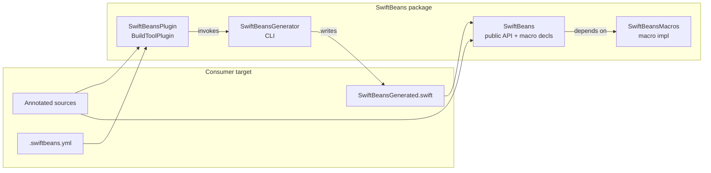

# Architecture: Compile-Time Spring-Style DI

Phase 2 contracts for [`SPEC.md`](SPEC.md). **Approved 2026-10-14.**

## Module seams



| Target | Kind | Responsibility |
|--------|------|----------------|
| `SwiftBeans` | library product | Public types (`BeanScope`, scan config), macro *declarations* (`#externalMacro`), re-exports for consumers |
| `SwiftBeansMacros` | `.macro` | Expand attached macros: local validation + minimal surface (no cross-file discovery) |
| `SwiftBeansGenerator` | executable | Parse scanned Swift sources + YAML; build IR graph; emit `SwiftBeansGenerated.swift`; emit diagnostics on failure |
| `SwiftBeansPlugin` | build tool plugin | Wire generator into the consumer build; pass target sources + resolved YAML paths |
| `SwiftBeansTests` | tests | BDD scenarios against fixtures that apply the plugin (Phase 3+) |
| `SwiftBeansMacrosTests` | tests | Macro expansion unit tests via SwiftSyntax |

Consumers depend on product `SwiftBeans` and attach plugin `SwiftBeansPlugin` to the target that owns `@ApplicationContext`.

## Division of labor: macros vs generator

| Concern | Owner | Why |
|---------|-------|-----|
| Attribute is valid Swift | Macros (`@ApplicationContext`, `@Configuration`, `@Bean`, `@Service`) | Compiler must recognize attributes |
| `@Bean` is `static` | Macro diagnostic on `@Bean` | Local to the declaration |
| Discover all `@Service` / `@Bean` / `@Configuration` / `@ApplicationContext` across files & YAML packages | **Generator** | Macros cannot see other files |
| Missing / duplicate / cycle checks | **Generator** | Needs full graph IR |
| Emit accessors + singleton storage on the context type | **Generator** → `SwiftBeansGenerated.swift` | Cross-cutting; written as a normal `extension` on the user’s context type |
| Optional peer helpers on a single type | Macros | Keep expansions small; prefer generator for graph output |

Macros are **not** the discovery engine. They are the public attribute API plus local checks. The generator is the Spring “component scan.”

## Public API contracts (library)

### `BeanScope`

```swift
public enum BeanScope: String, Sendable, Codable {
	case singleton
	case transient
}
```

Default when omitted on `@Service` / `@Bean`: `.singleton`.

### Scan config — file `.swiftbeans.yml`

Resolved relative to the consumer project / package root (generator searches upward from the target’s sources or receives an explicit path from the plugin).

```yaml
# .swiftbeans.yml
local_packages:
  - path: Packages/Networking
    targets:
      - Networking
```

Codable model (library + generator share the schema):

```swift
public struct SwiftBeansScanConfiguration: Codable, Sendable, Equatable {
	public var localPackages: [LocalPackage]

	public struct LocalPackage: Codable, Sendable, Equatable {
		public var path: String
		public var targets: [String]
	}
}
```

YAML keys use `local_packages` / `path` / `targets` (snake_case in file; `CodingKeys` map to camelCase in Swift).

Empty or missing file ⇒ scan only the plugin-attached target’s sources.

### Macro declaration surface (signatures)

Exact `#externalMacro` module names follow Package layout; semantics:

```swift
@attached(member, names: arbitrary) // storage hooks if needed; accessors primarily from generator
public macro ApplicationContext() = #externalMacro(...)

@attached(extension, conformances: /* none required in v1 */)
public macro Configuration() = #externalMacro(...)

@attached(peer) // or memberAttribute — validates static factory
public macro Bean(scope: BeanScope = .singleton) = #externalMacro(...)

@attached(peer) // attribute-only; optional diagnostic if no suitable init
public macro Service(
	boundTo: Any.Type? = nil,
	scope: BeanScope = .singleton
) = #externalMacro(...)
```

Phase 4 may simplify roles (e.g. marker macros that expand to `()`-empty) if the generator owns all codegen; the **names and parameters** above are the contract.

### Injectable key

v1 key = **fully qualified type name** of the provided type (protocol if `boundTo:` / protocol return type; else concrete type). No named qualifiers in v1.

## Generator IR (internal)

Not a public product API; documented for implementers:

```
ScanResult
  contexts: [ContextDecl]          // @ApplicationContext types (expect exactly one per graph / target in v1)
  configurations: [ConfigDecl]   // @Configuration types
  beans: [BeanProvider]          // static @Bean funcs → providedType, paramTypes, scope, source
  services: [ServiceProvider]    // @Service types → providedType (or boundTo), initParams, scope, source

Graph
  nodes: providers by InjectableKey
  edges: dependency → provider
  validate: missing | duplicate | cycle
```

v1 assumes **one** `@ApplicationContext` in the effective scan set. Multiple contexts → generator diagnostic (subcontexts later).

## Generated code shape

For `@ApplicationContext final class AppContext` and providers `UserService` (singleton), `Validator` (transient):

```swift
// SwiftBeansGenerated.swift (illustrative)
import SwiftBeans

extension AppContext {
	var userService: UserService {
		_swiftBeansRegistry.singleton(key: "UserService") {
			UserService(apiClient: self.apiClient)
		}
	}

	var validator: Validator {
		Validator(/* deps via self.* */)
	}
}
```

`SwiftBeansRegistry.singleton` runs `create` **outside** its lock so nested singleton factories (e.g. `UserService` → `apiClient`) do not re-enter a non-recursive lock.

Exact storage embedding (member macro property vs generated stored property) is an implementation detail; **observable contract** is:

- Camel-cased accessor per provided key (e.g. `userService` for `UserService`)
- Singleton: same instance for the lifetime of the context instance
- Transient: new instance per accessor call
- Construction calls `@Bean` static methods or `@Service` initializers with dependencies taken from other accessors

## Concurrency (v1 decision)

| Choice | Decision |
|--------|----------|
| Default isolation | **None forced** — users may add `@MainActor` to their context type |
| Singleton slots | **`SwiftBeansRegistry`** (`NSLock` + dictionary; create-outside-lock for nested deps) |
| Context type | Prefer `final class` so identity/lifetime match Spring-ish singleton-per-context |
| Sendable | Generated storage is Sendable-safe; user services need not be `Sendable` if the context is used from one actor — document that cross-actor sharing of non-Sendable beans is the user’s responsibility |

Rationale: a library package must work off the main actor and on Linux CI; forcing `@MainActor` on all graphs would hurt server/CLI use.

## Plugin invocation contract

1. Plugin runs on the consumer target.
2. Inputs: target Swift sources; optional `.swiftbeans.yml`; additional source roots from `local_packages`.
3. Output: one generated Swift file in the plugin work directory, compiled into the target.
4. Non-zero generator exit + stderr diagnostics ⇒ build failure (missing/duplicate/cycle).

## Testing seams (Phase 3 preview)

| Suite | What |
|-------|------|
| `SwiftBeansTests` | Scope enum / YAML decode; later fixture targets with plugin if SPM allows |
| `SwiftBeansMacrosTests` | Expansion + static-`@Bean` diagnostics |
| Generator unit tests | IR build + cycle/missing/duplicate on in-memory source strings (no full Xcode) |

## Example iOS app (manual integration harness)

**When:** After Phase 4 has macros + plugin working in package tests (or when validating Xcode plugin trust / `.swiftbeans.yml` multi-module scan). Not needed for Phase 3.

**Where:** [`Examples/SwiftBeansIOSExample/`](../../Examples/SwiftBeansIOSExample/) — a full Xcode iOS app that depends on this package via a relative local path, attaches `SwiftBeansPlugin` to the app target, and keeps `.swiftbeans.yml` at the example root. Human-owned project files are fine; agents should not invent the `.xcodeproj` unless asked.

## Out of architecture (still out of SPEC v1)

Runtime service locator, property injection, qualifiers, subcontexts, non-static `@Bean`.

## Phase gate

Phase 2 approved 2026-10-14. Proceed to Phase 3 (tests); scaffolding macro/plugin targets in `Package.swift` is allowed as needed for compiling tests.
