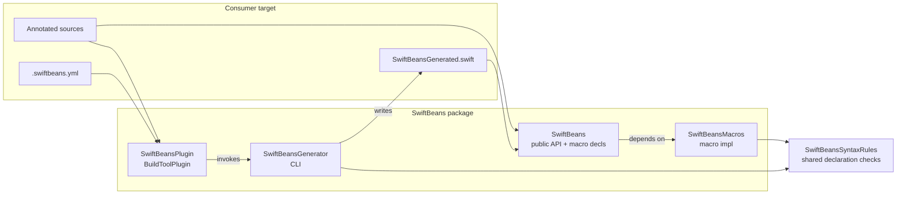
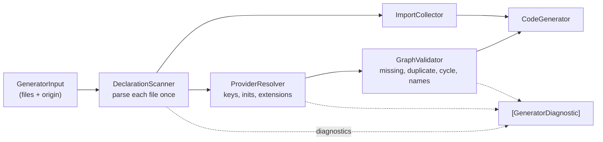

# Architecture: Compile-Time Spring-Style DI

Phase 2 contracts for [`SPEC.md`](SPEC.md). **Approved 2026-10-14.** The `@Assisted` additions approved 2026-10-15.

## Module seams



| Target | Kind | Responsibility |
|--------|------|----------------|
| `SwiftBeans` | library product | Public types (`BeanScope`, `Assisted`), macro *declarations* (`#externalMacro`), `SwiftBeansRegistry` |
| `SwiftBeansMacros` | `.macro` | Expand attached macros: local validation (as positioned `Diagnostic`s) + minimal surface (no cross-file discovery) |
| `SwiftBeansSyntaxRules` | internal library (SwiftSyntax only) | Declaration-local rules shared by macros and generator: attribute recognition (including the non-macro `@Assisted` marker), scope literal, `@Bean` / `@Service` / `@Inject` shape checks. One implementation, so the macro and the generator never disagree |
| `SwiftBeansGenerator` | executable | Parse the Swift files it is given; build IR graph; emit `SwiftBeansGenerated.swift`; emit diagnostics on failure. **Does not read `.swiftbeans.yml` or search for files.** |
| `SwiftBeansPlugin` | build tool plugin | Own the scan set: read the build system's file list and `.swiftbeans.yml`, resolve local package sources, declare all of them as inputs, invoke the generator with the explicit file list |
| `SwiftBeansGeneratorCore` | library (tests + generator) | Graph IR, parser, validator, codegen, diagnostics, and the scan-set resolver source of truth (see [Scan-set resolution](#scan-set-resolution)). Depends on `SwiftBeansSyntaxRules` + SwiftSyntax, **no longer on `SwiftBeans`** (it only needed `BeanScope`; scope is now parsed into the rules module's own enum). Still a package product until the later "product surface" batch; only `SwiftBeansGeneration` (below) is public |
| `SwiftBeansTests` | tests | BDD scenarios against fixtures that apply the plugin (Phase 3+) |
| `SwiftBeansMacrosTests` | tests | Macro expansion unit tests via SwiftSyntax |

Consumers depend on product `SwiftBeans` and attach plugin `SwiftBeansPlugin` to the target that owns `@ApplicationContext`.

## Division of labor: macros vs generator

| Concern | Owner | Why |
|---------|-------|-----|
| Attribute is valid Swift | Macros (`@ApplicationContext`, `@Configuration`, `@Bean`, `@Service`) | Compiler must recognize attributes |
| Single-declaration misuse: `@Bean` not `static` / no return type / `throws` / `async` / generic; `@Service` on protocol, enum or generic type; `@Inject` not on an initializer; non-literal `scope:` | `SwiftBeansSyntaxRules`, reported by the **macro** as a `Diagnostic` at the offending node | Inline in Xcode while editing; the generator runs the same rules and silently drops a violating declaration (the macro already fails the build), so nothing is reported twice |
| Discover all `@Service` / `@Bean` / `@Configuration` / `@ApplicationContext` across files & YAML packages | **Generator** | Macros cannot see other files |
| Missing / duplicate / cycle / accessor-collision checks, initializer selection, `#if` and public-ness checks, `@Bean` outside `@Configuration` | **Generator** | Needs other declarations (extensions, other files, origin of the file) |
| Emit accessors + singleton storage on the context type | **Generator** → `SwiftBeansGenerated.swift` | Cross-cutting; written as a normal `extension` on the user’s context type |
| Emit `{ContextTypeName}Protocol` + `extension Context: Protocol` | **Generator** → same file | Testable / Preview seam; same getters (and assisted methods) as accessors; fakes are user-owned. The protocol is top-level and named after the context's last name component (`App.Context` → `ContextProtocol`); the extension uses the qualified name |
| `@Assisted` usage: default value / `inout` / variadic on an assisted parameter, `@Assisted` on a stored property, explicit `scope: .singleton` on an assisted provider, an assisted key injected into another bean | **Generator** only (SPEC Assisted providers, rule 9) | The selected initializer may live in another file, and `@Assisted` is a property wrapper, not a macro, so there is nothing for a macro to attach to. `SwiftBeansSyntaxRules` only supplies the recognizer |
| Optional peer helpers on a single type | Macros | Keep expansions small; prefer generator for graph output |

Macros are **not** the discovery engine. They are the public attribute API plus local checks. The generator is the Spring “component scan.”

## Public API contracts (library)

### `BeanScope`

```swift
public enum BeanScope: String, Sendable, Codable {
	case singleton
	case transient
}
```

Default when omitted on `@Service` / `@Bean`: `.singleton`.

### `Assisted`

New file `Sources/SwiftBeans/Assisted.swift`:

```swift
/// Marks an initializer or `@Bean` parameter as a runtime argument (assisted injection).
@propertyWrapper
@frozen
public struct Assisted<Value> {
	public let wrappedValue: Value
	@inlinable public init(wrappedValue: Value) { self.wrappedValue = wrappedValue }
}

extension Assisted: Sendable where Value: Sendable {}
```

- It has **no `projectedValue` and no `init(projectedValue:)`**, so it is an implementation-detail parameter wrapper (SE-0293): callers pass a plain `Value`, and the body sees a plain `Value`. Manual construction (`ItemDetailViewModel(repository: fake, item: item)`) needs nothing extra.
- It is not a macro: there is no `#externalMacro` declaration, no entry in `SwiftBeansMacros`, and therefore no macro diagnostics. All checks are the generator's (see [Assisted providers](#assisted-providers)).
- It stays in the runtime library because it is referenced from the consumer's source; the generator recognizes it by syntax only and never links it.

### Scan config — file `.swiftbeans.yml`

Read **only** from the scan root: `PluginContext.package.directoryURL` (SPM) or `XcodePluginContext.xcodeProject.directoryURL` (Xcode, the folder containing the `.xcodeproj`). No upward search by the plugin or the generator.

```yaml
# .swiftbeans.yml
local_packages:
  - path: Packages/Networking
    targets:
      - Networking
```

Model (Foundation-only; lives with the resolver, **not** in the `SwiftBeans` runtime library, which consumers link into their apps):

```swift
struct SwiftBeansScanConfiguration: Equatable, Sendable {
	var localPackages: [LocalPackage]

	struct LocalPackage: Equatable, Sendable {
		var path: String
		var targets: [String]
		var line: Int // 1-based line of the `- path:` entry, for diagnostics
	}
}
```

YAML keys use `local_packages` / `path` / `targets`. Accepted syntax: block lists, optional single or double quotes around scalars, `#` comments outside quotes, `local_packages: []`. Anything else is a `ScanConfigurationError` with a line number.

Empty or missing file ⇒ scan only the plugin-attached target’s sources.

`public struct SwiftBeansScanConfiguration` is **removed** from the `SwiftBeans` library (pre-1.0, no published release). It was never used at runtime.

### Macro declaration surface (signatures)

```swift
@attached(member, names: named(_swiftBeansRegistry))
public macro ApplicationContext() = #externalMacro(module: "SwiftBeansMacros", type: "ApplicationContextMacro")

@attached(member)
public macro Configuration() = #externalMacro(module: "SwiftBeansMacros", type: "ConfigurationMacro")

@attached(peer)
public macro Bean(scope: BeanScope = .singleton) = #externalMacro(module: "SwiftBeansMacros", type: "BeanMacro")

@attached(member)
public macro Service(scope: BeanScope = .singleton) = #externalMacro(module: "SwiftBeansMacros", type: "ServiceMacro")
@attached(member)
public macro Service(boundTo: Any.Type, scope: BeanScope = .singleton) = #externalMacro(module: "SwiftBeansMacros", type: "ServiceMacro")

/// New (2026-10-15): marks the initializer the graph calls when a `@Service` has several.
@attached(peer)
public macro Inject() = #externalMacro(module: "SwiftBeansMacros", type: "InjectMacro")
```

All macros expand to nothing except `@ApplicationContext` (adds `let _swiftBeansRegistry = SwiftBeansRegistry()`). They report problems with `context.diagnose(Diagnostic(node:message:))` at the offending syntax node (the `static` keyword's absence is reported at `func`, `throws` at the effect specifier, a bad `scope:` at the argument, etc.) and return `[]`, instead of throwing a bare string. `SwiftBeansMacroError` is replaced by `SwiftBeansSyntaxRules.Violation` → `DiagnosticMessage`.

### `SwiftBeansSyntaxRules` (internal module)

```swift
enum SwiftBeansAttribute: String { case applicationContext, configuration, bean, service, inject }

/// `@Service` / `@SwiftBeans.Service` → `.service`; `@Other.Service` → nil.
func swiftBeansAttribute(_ attribute: AttributeSyntax) -> SwiftBeansAttribute?

enum ScopeLiteral { case singleton, transient }
/// `.singleton`, `BeanScope.singleton`, `SwiftBeans.BeanScope.singleton`; nil + violation otherwise.
func scopeArgument(of attribute: AttributeSyntax) -> Result<ScopeLiteral, Violation>   // default .singleton when absent

struct Violation: Error, Equatable {
	var node: Syntax       // where to point
	var message: String
	var id: String         // stable diagnostic id, e.g. "bean.notStatic"
}

func beanViolations(_ function: FunctionDeclSyntax, attribute: AttributeSyntax) -> [Violation]
func serviceViolations(_ declaration: some DeclSyntaxProtocol, attribute: AttributeSyntax) -> [Violation]
func configurationViolations(_ declaration: some DeclSyntaxProtocol) -> [Violation]
func applicationContextViolations(_ declaration: some DeclSyntaxProtocol) -> [Violation]
func injectViolations(_ declaration: some DeclSyntaxProtocol) -> [Violation]
```

`@Assisted` recognition is added next to `swiftBeansAttribute`, **without** a new `SwiftBeansAttribute` case, because that enum lists the macros (`CaseIterable`, `Violation`-producing attributes) and `Assisted` is a property wrapper with no macro and no violations here:

```swift
/// `Assisted`, `SwiftBeans.Assisted`; `@Other.Assisted` → false. Generic arguments are not part of an attribute name.
func isAssisted(_ attribute: AttributeSyntax) -> Bool
/// True when any attribute on the parameter is `@Assisted` / `@SwiftBeans.Assisted`.
static func isAssisted(_ parameter: FunctionParameterSyntax) -> Bool
```

(Both are `SwiftBeansSyntaxRules` statics, like the existing helpers. The stored-property case reuses the attribute overload.)

## Generator pipeline (internal)



Each stage **collects** diagnostics instead of throwing on the first problem; code is generated only when the final list has no errors. Every source file is parsed exactly once (`Parser.parse` + one `SourceLocationConverter`).

### Public entry point (the only public API of `SwiftBeansGeneratorCore`)

```swift
public struct GeneratorInput: Sendable, Codable, Equatable {
	public var targetSources: [String]                 // absolute paths
	public var localPackages: [LocalPackageSources]
	public struct LocalPackageSources: Sendable, Codable, Equatable {
		public var module: String                      // Swift module name of the package target
		public var sources: [String]
	}
}

public struct GeneratorDiagnostic: Sendable, Equatable {
	public enum Severity: Sendable { case error, warning, note }
	public var severity: Severity
	public var id: String                              // stable, e.g. "graph.missingDependency"
	public var location: SourcePosition
	public var message: String
	public var notes: [GeneratorDiagnostic]            // severity .note
	/// `<file>:<line>:<column>: error: <message>` followed by note lines.
	public var rendered: String
}

public struct SourcePosition: Sendable, Equatable, Comparable { // (file, line, column); 1-based
	public var file: String
	public var line: Int
	public var column: Int
}

public struct GenerationResult: Sendable, Equatable {
	public var diagnostics: [GeneratorDiagnostic]      // sorted (file, line, column, message)
	public var output: String?                         // nil iff diagnostics contain an error
}

public enum SwiftBeansGeneration {
	/// Reads the files, then runs `generate(sources:)`.
	public static func generate(input: GeneratorInput, fileManager: FileManager = .default) -> GenerationResult
	/// In-memory entry for tests: path → text with an origin.
	public static func generate(sources: [SourceFile]) -> GenerationResult
}

public struct SourceFile: Sendable, Equatable {
	public enum Origin: Sendable, Equatable { case target, localPackage(module: String) }
	public var path: String
	public var text: String
	public var origin: Origin
}
```

`BeanSourceParser`, `BeanGraphValidator`, `BeanCodeGenerator`, `BeanGraph`, `BeanProvider`, `InjectableKey`, `BeanParameter`, `BeanFactoryKind` and `BeanGraphError` become **internal** (tests use `@testable import`) and are reshaped as below. `BeanGraphError` is replaced by `GeneratorDiagnostic` ids; `.notImplemented` is removed. The `contextTypeName: "AppContext"` default parameter is removed.

### Declarations and origin

```swift
struct ScannedFile {
	var source: SourceFile
	var contexts: [ContextDecl]          // @ApplicationContext classes (qualified name, location)
	var typeDecls: [TypeDecl]            // every class/struct/actor/enum, with qualified name, so extensions can be matched
	var extensions: [ExtensionDecl]      // extended type's qualified spelling + members
	var annotated: [AnnotatedDecl]       // @Service / @Configuration / @Bean / @Inject that passed SyntaxRules
	var conditionalAnnotations: [Location] // annotated decls under #if → "#if not supported" diagnostics
	var assistedPropertyLocations: [SourcePosition] // `@Assisted` on stored properties of scanned types → `assisted.property`
	var imports: [ImportRecord]
}

struct ParameterInfo {
	var label: String?                  // nil for `_`
	/// The second name when present, else the first; as spelled, backticks included.
	var internalName: String
	var hasDefault: Bool
	var location: SourcePosition        // the parameter
	var typeLocation: SourcePosition
	var key: Result<KeyNormalization.Normalized, UnsupportedKey>?
	var typeSpelling: String
	var isAssisted: Bool                // @Assisted / @SwiftBeans.Assisted
	var isVariadic: Bool                // `T...`
	var isInout: Bool                   // `inout T`
	var defaultLocation: SourcePosition? // the default value expression, when written
}

// ServiceDecl and BeanDecl each gain:
//	var scopeLocation: SourcePosition?  // the `scope:` argument; non-nil only when written explicitly
```

(The first six `ParameterInfo` fields exist today; the last four are new. In the code, annotated declarations are `ServiceDecl` / `BeanDecl` and `ScannedFile` names them `services` / `beans` / `types` / `conditionalDecls`; the `ScannedFile` sketch above keeps its earlier names.)

`ServiceDecl.scope` / `BeanDecl.scope` still default to `.singleton` when `scope:` is absent or non-literal. `scopeLocation` is what lets the resolver tell an explicit `.singleton` (error on an assisted provider) from the default (silently transient). A non-literal `scope:` has a `scopeLocation` but is the macro's error, so the resolver ignores it for `assisted.singleton`; only a literal `.singleton` is reported.

The scanner records `@Assisted` on stored properties of every scanned class/struct/actor/enum into `assistedPropertyLocations` (the attribute's position). Whether the type is a `@Service` is irrelevant ("scanned type" in the SPEC means any type in the scan set).

- **Qualified names:** a declaration's name is the chain of enclosing type / extension names joined with `.` (`extension Outer { class Inner }` → `Outer.Inner`).
- **Origin:** `.target` files supply root contexts and providers; `.localPackage(module:)` files supply providers only (their contexts are ignored) and trigger the public-ness checks and the module import.
- **Recognition** goes through `swiftBeansAttribute(_:)` so `@SwiftBeans.Service` counts and `@Other.Service` does not.

### Injectable keys

```swift
/// Normalized type used as a graph key. `any` is not part of the key.
indirect enum TypeKey: Hashable, Comparable {
	case nominal([NominalComponent])           // Outer.Inner<…>
	case array(TypeKey)                        // [T] and Array<T>
	case dictionary(TypeKey, TypeKey)          // [K: V] and Dictionary<K, V>

	struct NominalComponent: Hashable { var name: String; var genericArguments: [TypeKey] }

	/// Canonical spelling, e.g. `Outer.Inner`, `[String: User]`, `Cache<User>`.
	var description: String
	/// SPEC accessor naming table; keywords are returned already escaped (`` `class` ``).
	var accessorName: String
}

enum KeyNormalization {
	/// Strips `any`, parentheses and whitespace; desugars nothing else.
	/// Returns `.unsupported(reason)` for optionals, IUOs, tuples, functions, `some`, metatypes,
	/// `Self`, and protocol compositions (`any A & B`).
	static func key(for type: TypeSyntax) -> Result<(key: TypeKey, spelledWithAny: Bool), UnsupportedKey>
}
```

The accessor's declared type is `key.description`, prefixed with `any ` when **any** occurrence of the key in the graph (provider or dependency) had `spelledWithAny`. Registry keys use `accessorName` with backticks removed.

Missing-dependency hints: among provider keys whose last nominal component name equals the missing key's last component name, the diagnostic adds a note "did you mean '…' (provided by …)?".

### Providers

```swift
struct BeanProvider {
	var key: TypeKey
	var scope: ScopeLiteral
	var origin: SourceFile.Origin
	var location: SourcePosition              // attribute / declaration for diagnostics
	var displayName: String                   // `ReportService`, `AppConfiguration.urlSession`
	var construction: Construction
	var parameters: [BeanParameter]

	enum Construction: Equatable { case initializer(typeName: String), staticMethod(typeName: String, name: String) }

	/// True when any parameter is `@Assisted`: the accessor is a method, not a property.
	var isAssisted: Bool { parameters.contains { $0.assisted != nil } }
}

struct BeanParameter {
	var label: String?                        // nil for `_`
	var key: TypeKey?                         // nil when unsupported/unwritten, and always nil when `assisted != nil`
	var spelledWithAny: Bool
	var hasDefault: Bool                      // optional dependency
	var location: SourcePosition              // the parameter, for missing-dependency errors
	var assisted: AssistedArgument?           // non-nil for an `@Assisted` parameter
}

/// A runtime argument of an assisted provider's method accessor.
struct AssistedArgument {
	var label: String?                        // external label; nil for `_`
	var internalName: String                  // as spelled, backticks included
	var typeSpelling: String                  // as written in the source
}
```

`ProviderResolver` builds these from `annotated` declarations plus all `typeDecls` / `extensions` across files:

- **Initializer candidates** = initializers in the type body + in `ExtensionDecl`s whose extended spelling equals the type's qualified name, minus `private` / `fileprivate` / failable. Selection per SPEC (`@Inject`, memberwise for structs, `init()` for classes/actors). `throws` / `async` on the selected initializer is a generator diagnostic (the macro cannot see which initializer is selected).
- **Memberwise** parameters: stored `let`/`var` without accessors, not `static`/`lazy`, in declaration order; `let x = …` excluded; `var x: T = …` → `hasDefault`. A stored property with an attribute (property wrapper) and no declared init → diagnostic.
- **Defaulted parameter of type `T?`** is looked up as `T`.
- **Assisted parameters** (`ParameterInfo.isAssisted`) get `assisted = AssistedArgument(label:internalName:typeSpelling:)` and `key = nil`. The resolver does no key normalization for them, so the key restrictions (optionals, tuples, functions…) produce no `key.unsupported` error. If the provider has any assisted parameter, `BeanProvider.scope` is forced to `.transient`.
- **Assisted diagnostics** (errors, from the resolver, only for the *selected* initializer / `@Bean` method; assisted parameters elsewhere have no effect, SPEC rule 8):

  | id | Location | When |
  |----|----------|------|
  | `assisted.singleton` | the `scope:` argument (`scopeLocation`) | provider is assisted and `scope:` is literally `.singleton` |
  | `assisted.default` | the default value (`defaultLocation`) | assisted parameter has a default |
  | `assisted.variadic` | the parameter | assisted parameter is variadic |
  | `assisted.inout` | the parameter | assisted parameter is `inout` |
  | `assisted.property` | the attribute (`assistedPropertyLocations`) | `@Assisted` on a stored property of a scanned type |

  A provider with one of the first four errors is still emitted best-effort (so the graph checks that follow do not cascade into spurious missing-dependency errors); no output is generated anyway because errors exist.
- For memberwise initializers, a stored property carrying `@Assisted` is already `assisted.property`; it is not also treated as an assisted parameter.
- **Public-ness** (local packages only): type modifier `public`/`open`, initializer `public`; for `@Bean`, configuration type `public` and function `public`.
- **`@Bean` placement**: the enclosing type (declared or extended) must be a `@Configuration` type somewhere in the scan set.

### Validation

`GraphValidator.validate(providers:context:) -> (graph: BeanGraph?, diagnostics: [GeneratorDiagnostic])` checks, collecting all of them:

1. duplicate keys (error at every provider of the key),
2. accessor-name collisions between different keys (error at every provider),
3. missing non-defaulted dependencies (error at the parameter; hint note). Assisted parameters (`key == nil`, `assisted != nil`) are skipped: their types are not keys,
4. **assisted keys are not injectable** (id `assisted.notInjectable`): a non-defaulted parameter whose key is provided **only** by an assisted provider is an error at the consumer's parameter. The message says the type takes runtime arguments and names the method selector, e.g. `itemDetailViewModel(item:)` (accessor name, then each assisted label, `_` for none, each followed by `:`). A defaulted parameter whose key is assisted keeps its default: it is neither an error nor an edge (it behaves like an unprovided optional dependency, and the generated call omits it),
5. cycles over **injected** edges only: edges come only from parameters that have a key and whose provider is not assisted (a defaulted parameter whose key is not provided, or is assisted, is not an edge). Each strongly connected component is reported once: error at the provider with the smallest location, notes at the others.

Duplicate-key and accessor-collision checks (1, 2) are unchanged and include assisted providers; an assisted provider and a plain provider of the same key are duplicates. Assisted providers take part in cycle detection through their own injected parameters.

Iteration is over providers sorted by `(key.description, location)`, never over dictionary order.

### Imports

```swift
struct ImportRecord: Hashable {
	var module: String                         // first path component
	var testable: Bool
	var preconcurrency: Bool
	var condition: String?                     // nil = unconditional; else a #if expression
}
```

- Top-level `import` → `condition: nil`. An import inside a top-level `#if` clause gets that clause's effective condition: `#if a` → `a`; `#elseif b` → `!(a) && (b)`; `#else` → `!(a) && !(b)`. Nested `#if` clauses combine with `&&`.
- Merge per `(module, condition)`; an unconditional import of a module drops conditional ones for it. `testable` / `preconcurrency` are OR-ed.
- Emitted: `Foundation`, `SwiftBeans`, then unconditional imports sorted, then one `#if <condition>` block per condition (sorted) — except `Swift`, which is never emitted.
- Every `localPackage(module:)` that contributes a provider adds an unconditional `import <module>`.
- The previous skip list (`SwiftUI`, `UIKit`, `Testing`, …) is removed: test files are never in the scan set, and skipping UI modules broke beans of UI types.

## Generated code shape

For `@ApplicationContext final class AppContext` and providers `UserService` (singleton), `Validator` (transient), `any Store` (bound service):

```swift
// Generated by SwiftBeans — do not edit.
import Foundation
import SwiftBeans
import Networking

protocol AppContextProtocol: AnyObject {
	var store: any Store { get }
	var userService: UserService { get }
	var validator: Validator { get }
}

extension AppContext {
	var store: any Store {
		_swiftBeansRegistry.singleton(key: "store") {
			DiskStore()
		}
	}

	var userService: UserService {
		_swiftBeansRegistry.singleton(key: "userService") {
			UserService(apiClient: self.apiClient)
		}
	}

	var validator: Validator {
		Validator()
	}
}

extension AppContext: AppContextProtocol {}
```

- Accessors and protocol requirements are sorted by accessor name.
- Construction uses the qualified type name (`Features.Search(...)`) and passes only injected parameters; defaulted parameters without a provider are omitted.

### Assisted providers

For `@Service final class ItemDetailViewModel { init(repository: ItemRepository, @Assisted item: Item) }` (the protocol requirement and extension member sort by accessor name with everything else):

```swift
protocol AppContextProtocol: AnyObject {
	func itemDetailViewModel(item: Item) -> ItemDetailViewModel
	var itemRepository: ItemRepository { get }
}

extension AppContext {
	func itemDetailViewModel(item: Item) -> ItemDetailViewModel {
		ItemDetailViewModel(repository: self.itemRepository, item: item)
	}
}
```

- **Signature:** the assisted parameters in declaration order, rendered `label: Type` when the label equals the internal name, `label internal: Type` when they differ, and `_ internal: Type` when there is no label. Types are the source spelling.
- **Call:** every parameter in the *initializer's* declaration order. An assisted parameter passes `label: internalName`, or just `internalName` for `_`; graph parameters are exactly as for properties (`label: self.x`, omitted when defaulted and unprovided). Example: `init(@Assisted _ query: String, api: API, @Assisted page pageIndex: Int)` → `func search(_ query: String, page pageIndex: Int) -> Search { Search(query, api: self.api, page: pageIndex) }`.
- **Return type:** the key's declared type, with the same `any` spelling rule as for properties.
- **Ordering and collisions:** still sorted by accessor name; an assisted provider's accessor name takes part in collision checks like any other.
- **No registry use:** the body is a plain construction (always transient), never `_swiftBeansRegistry`.
- **`@Bean`:** the body is `Configuration.method(args)` with the same argument rules.
- No root context → the file contains only the header comment and imports `Foundation`.
- The output file is written only when its bytes differ from the existing file. (The generator still runs whenever an input changes; only downstream recompilation is avoided.)

## Concurrency (v1 decision)

| Choice | Decision |
|--------|----------|
| Default isolation | **None forced** — users may add `@MainActor` to their context type |
| Singleton slots | **`SwiftBeansRegistry`**: per-key once-only creation (below) |
| Context type | Prefer `final class` so identity/lifetime match Spring-ish singleton-per-context |
| Sendable | Registry state is thread-safe; user services need not be `Sendable` if the context is used from one actor — cross-actor sharing of non-Sendable beans is the user's responsibility. The registry stays `@unchecked Sendable` with that documented on the type |

Rationale: a library package must work off the main actor and on Linux CI; forcing `@MainActor` on all graphs would hurt server/CLI use.

### `SwiftBeansRegistry` contract (revised 2026-10-15)

```swift
public final class SwiftBeansRegistry: @unchecked Sendable {
	public init()
	/// Returns the instance for `key`, creating it with `create` at most once per registry.
	public func singleton<T>(key: String, create: () -> T) -> T
}
```

Algorithm (one `NSCondition`, available on Apple platforms and Linux Foundation):

```
lock
loop:
  slot[key] == .ready(value)       → unlock; return value
  slot[key] == .creating(owner)    → owner == current thread ? preconditionFailure("cyclic singleton resolution: key")
                                                              : wait; continue loop
  slot[key] == nil                 → slot[key] = .creating(current thread); break
unlock
value = create()                   // outside the lock: nested resolution and unrelated keys proceed
lock; slot[key] = .ready(value); broadcast; unlock
return value
```

- Once-only: only the thread that set `.creating` runs `create`; racers wait and read the stored value.
- Nested resolution works because `create` runs without the lock held; waiting happens only on *other* keys' in-flight creation, and the build-time cycle check guarantees those waits form no cycle.
- Unrelated keys never wait on each other's factories (no global serialization), so a factory that hops to the main thread does not deadlock a main-thread resolve of a different bean.
- `create` cannot throw (accessors are non-throwing), so `.creating` is always resolved unless the process traps.
- Keys are accessor names, which the generator guarantees unique per context.

## Plugin invocation contract

Revised 2026-10-15 for SPEC → *Source discovery*.

### Responsibilities

| Step | Owner |
|------|-------|
| List target sources | Plugin — SPM: `SourceModuleTarget.sourceFiles(withSuffix: "swift")`; Xcode: `XcodeTarget.inputFiles` filtered to `.source` + `.swift` |
| Locate `.swiftbeans.yml` | Plugin — scan root only (see above) |
| Parse config + resolve local package sources | Plugin, via the shared resolver |
| Declare build inputs | Plugin — target sources ∪ local package sources ∪ config file (when present) |
| Parse sources, validate graph, write output | Generator |

No folder walking of the target, no source-root inference, no file-name markers. `expandedSwiftSources`, `inferSourceRoot`, `findConfig` (plugin) and `findConfiguration` / `--config` (generator) are deleted.

**Verified 2026-10-15 (Xcode 27.0, 27A266a):** for the example app's `PBXFileSystemSynchronizedRootGroup`, `XcodeTarget.inputFiles` lists every Swift file in nested subfolders (`Data/`, `DI/`, `Domain/`, `Navigation/`, `Presentation/`) as `.source`, and `xcodeProject.directoryURL` is `Examples/SwiftBeansExample`. The old recursive rescan is not needed. (The old heuristic only ever ran because `inputFiles.first` sat in a subfolder.)

### Generator CLI

```
SwiftBeansGenerator --output <file> --input <generator-input.json>
SwiftBeansGenerator --output <file> <source.swift>...      # debugging: all files are target sources
```

- The plugin writes `GeneratorInput` as JSON to `<pluginWorkDirectory>/SwiftBeansInput.json` (only when its bytes change) and passes `--input`. This replaces one argument per file, which could exceed the OS argument-length limit on large apps, and carries each local package file's module.
- The JSON file is a declared input too, so a re-planned file list reruns the generator.
- `GeneratorInput` is declared in the shared `ScanSetResolution.swift` (public, Foundation-only), so the plugin's encoder and the generator's decoder are the same code, kept identical by the drift guard. `SwiftBeansGeneratorCore` re-exposes it from there.
- Local package module name = the target name with characters that are not valid in a Swift identifier replaced by `_` (SwiftPM's `c99name`).
- Sources are de-duplicated by resolved path and sorted (SPEC rule 6). A path listed both as a target source and a package source counts as a target source.
- Every diagnostic is printed to stderr as its `rendered` form. Exit code is 1 if any error was reported, else 0. Warnings alone do not fail.

### Scan-set resolution

A single Foundation-only Swift file, `ScanSetResolution.swift`, holds:

```swift
enum ScanConfigurationParser {
	static func parse(_ text: String) throws(ScanConfigurationError) -> SwiftBeansScanConfiguration
}

enum ScanSetResolver {
	/// Resolves `local_packages` to one entry per listed target (in config order), each with its
	/// sorted `.swift` files. Paths are relative to `configDirectory`, standardized and symlink-resolved;
	/// a file reached through two entries is kept only in the first.
	static func localPackageSources(
		for configuration: SwiftBeansScanConfiguration,
		configDirectory: URL,
		fileManager: FileManager = .default
	) throws(ScanConfigurationError) -> [LocalPackageTargetSources]
}

struct LocalPackageTargetSources: Equatable, Sendable {
	var target: String       // as written in the config
	var module: String       // c99name of `target`
	var files: [URL]
}

struct ScanConfigurationError: Error, CustomStringConvertible {
	enum Kind: Equatable { case unreadable, syntax, missingPackage, notAPackage, missingTarget }
	var kind: Kind
	var line: Int?      // in the config file
	var message: String // names the entry, e.g. "local_packages[1] path 'Packages/Net': no Package.swift"
}
```

Why one file shared by copy: build tool plugins cannot depend on library targets, and the plugin must know the full file list at planning time to declare it as inputs (a separate "resolve" build step cannot add inputs to a later step). So:

- **Canonical copy:** `Sources/SwiftBeansGeneratorCore/ScanSetResolution.swift` (unit-tested).
- **Plugin copy:** `Plugins/SwiftBeansPlugin/ScanSetResolution.swift`, byte-identical.
- **Drift guard:** a `SwiftBeansGeneratorCoreTests` test reads both files via `#filePath` and fails if they differ.

Symlinks were rejected because the example already relies on them and they break on some checkouts.

### Errors

On a `ScanConfigurationError` the plugin emits `Diagnostics.error(message, file: <config path>, line:)` and returns no build commands, so the build fails with a clickable diagnostic on the config entry. It does not also rethrow (that duplicates the message). It never skips an entry silently.

### Plugin shape

`createBuildCommands` (SPM) and the `XcodeBuildToolPlugin` variant differ only in how they obtain `(sourceFiles, scanRoot, targetName)`; both call one shared `makeCommands(...)` that resolves the config, writes `SwiftBeansInput.json`, and returns the single `.buildCommand` (`--output`, `--input`; inputs = target sources ∪ package sources ∪ config ∪ input JSON).

### Known limitation

Neither SPM nor Xcode re-plans plugins when an *undeclared* file appears, so a new `.swift` file in a local package (or a newly created `.swiftbeans.yml`) may need a re-plan / clean build to join the graph (SPEC → Known limitations).

## Testing seams

| Suite | What |
|-------|------|
| `SwiftBeansTests` | Scope enum; `Assisted` (a function taking `@Assisted x: Int` is callable with a plain `Int`, and the body sees `Int`); registry: concurrent first access runs the factory once (counter + many tasks/threads), nested resolution, same instance per key, distinct keys independent |
| `SwiftBeansGeneratorCoreTests` | Config parser + resolver (incl. module names / per-target grouping), plugin-copy drift guard. **Generator rules** via `SwiftBeansGeneration.generate(sources:)` on in-memory files: one test (or parameterized group) per SPEC scenario, asserting either output fragments or the exact sorted `rendered` diagnostics (ids, file, line, column). Focused units: `KeyNormalization` / `accessorName` table, initializer selection, import merging. **Assisted:** new file `Tests/SwiftBeansGeneratorCoreTests/GeneratorAssistedTests.swift` maps the six SPEC scenarios (method accessor, labels and order, `@Bean`, not injectable, not singleton, unsupported usage): output text plus diagnostic ids (`assisted.singleton` / `.default` / `.variadic` / `.inout` / `.property` / `.notInjectable`) and `file:line:column` |
| `SwiftBeansMacrosTests` | Expansion + diagnostics with positions (`assertMacroExpansion` `diagnostics:`) for every macro-owned rule, `@Inject` |
| Generated-code compile check | Package tests assert output text only. The example app (which gains a local-package bean and nested / generic-collection / `any`-bound beans) is the compile check for generated code |
| Example app as `@Assisted` compile check | `ItemDetailViewModel` becomes `init(repository: ItemRepository, @Assisted item: Item)`, replacing `load(seed:)` with a refresh that uses the stored item; `AppCoordinator` and the Previews call `context.itemDetailViewModel(item:)`; `FakeAppContext` implements the method |
| Example app (manual) | Source-discovery scenarios; local-package import + public-ness with a real build; Xcode shows `file:line:column` diagnostics as clickable issues |

## Example app (manual integration harness)

**When:** After Phase 4 has macros + plugin working in package tests (or when validating Xcode plugin trust / `.swiftbeans.yml` multi-module scan). Not needed for Phase 3.

**Where:** [`Examples/SwiftBeansExample/`](../../Examples/SwiftBeansExample/) — a multiplatform Xcode SwiftUI app (iOS + macOS) that depends on this package via a relative local path, attaches `SwiftBeansPlugin` to the app target, and keeps `.swiftbeans.yml` at the example root. Human-owned project files are fine; agents should not invent the `.xcodeproj` unless asked.

## Out of architecture (still out of SPEC v1)

Runtime service locator, property injection, qualifiers, subcontexts, non-static `@Bean`.

## Phase gate

Phase 2 approved 2026-10-14. Proceed to Phase 3 (tests); scaffolding macro/plugin targets in `Package.swift` is allowed as needed for compiling tests.

**Generator rules + Singleton storage revision (2026-10-15):** Phase 1 approved 2026-10-15. Phase 2 (this document: `SwiftBeansSyntaxRules`, diagnostics model, `TypeKey`, provider resolution, imports, `--input` JSON, registry algorithm) approved 2026-10-15. Phase 3 tests written 2026-10-15 (generator suites per SPEC section, `TypeKeyTests`, macro diagnostics, `SwiftBeansRegistryTests` incl. exit test); they compile and fail only against stubs. Phase 4 implemented 2026-10-15: `swift test` green (113 tests), example app builds and tests through the plugin's `--input` JSON. Legacy `BeanSourceParser` / `BeanGraphValidator` / `BeanCodeGenerator` / `Naming` removed; `SwiftBeansGeneratorCore` no longer depends on `SwiftBeans`. The example now carries the generated-code compile check (local package `GreetingKit`, nested, `[String: Int]` and `@Inject` beans).

**Runtime arguments (`@Assisted`):** Phase 1 approved 2026-10-15. Phase 2 approved 2026-10-15 (the `Assisted` runtime contract, `SwiftBeansSyntaxRules.isAssisted`, scanner / resolver / validator / generator seams, and the testing plan above). Phases 3–4 implemented 2026-10-15 (`swift test`: 133 tests; example app green).

**Macro-owned misuse in the generator:** declarations that violate a macro-owned rule stay in the graph best-effort and are not reported again (e.g. a non-literal `scope:` is wired as singleton), so the only error the user sees is the macro's inline one.

**Source discovery revision (2026-10-15):** Phases 2–4 done. Config errors are reported with `Diagnostics.error` alone (no rethrow): SPM and Xcode both fail the build on it, and rethrowing printed every message twice.
