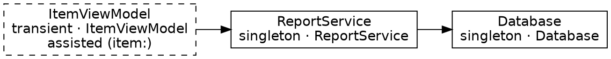

# Spec: Graph Dump

## Metadata

| Field | Value |
|-------|-------|
| Feature | `graph-dump` |
| Status | Approved (Phase 1) — 2026-10-15, from the design brief for this branch; extends `specs/compile-time-di/SPEC.md` ("Generated file") |
| Targets touched | `SwiftBeansGeneratorCore` (dump text), `SwiftBeansGenerator` (CLI), `SwiftBeansPlugin` (outputs) |
| Public API | None. The only new surface is two generator CLI options and two plugin output files |

## Goal

After a successful generation, also write a human-readable Markdown file and a Graphviz DOT file describing the resolved bean graph, so developers can debug wiring and onboard onto an unfamiliar codebase without reading `SwiftBeansGenerated.swift`.

## Files

| File | Purpose |
|------|---------|
| `SwiftBeansGraph.md` | Human-readable: provider table + dependency list |
| `SwiftBeansGraph.dot` | Graphviz source (`dot -Tsvg SwiftBeansGraph.dot -o graph.svg`) |

Both are written next to `SwiftBeansGenerated.swift`, i.e. in the plugin work directory of the target (SPM: `.build/plugins/outputs/<package>/<target>/destination/SwiftBeansPlugin/`; Xcode: the target's plugin work folder under DerivedData). They are build artifacts: never edited or committed.

## Generator CLI

```
SwiftBeansGenerator --output <file> [--graph-markdown <file>] [--graph-dot <file>] --input <generator-input.json>
```

- `--graph-markdown` / `--graph-dot` are optional and independent. Without them the generator behaves as before.
- The plugin always passes both (v1 has no toggle; see Out of scope).
- Like the Swift output, each graph file is rewritten only when its contents change.
- Nothing is written (and no stale graph is touched) when generation fails with an error.

## Content rules

1. **Nodes** are providers. Each node shows: key (canonical spelling), accessor name, scope (`singleton` / `transient`), display name (`ReportService`, `AppConfiguration.urlSession`), and the assisted flag with its runtime arguments (`item:`; `_:` for an unlabeled one).
2. **Edges** are injected dependencies: provider → provider that supplies one of its non-assisted parameters. Assisted parameters are runtime arguments, not edges.
3. A parameter that resolves to no provider (an unprovided defaulted parameter, or one with no supported key) is not an edge.
4. Two parameters of the same key give one edge.
5. **Order is stable**: nodes by key (then location), edges by (from key, to key). The output is a pure function of the scanned sources, like the Swift output.
6. The Markdown names the root context (or states there is none) and the node/edge counts.
7. A target without an `@ApplicationContext` still gets both files; they describe whatever providers it declares.

### `SwiftBeansGraph.md` shape

```markdown
# SwiftBeans graph

- Context: `AppContext`
- Providers: 3
- Dependencies: 2

## Providers

| Key | Accessor | Scope | Provided by | Assisted |
|-----|----------|-------|-------------|----------|
| `Database` | `database` | singleton | `Database` | — |
| `ItemViewModel` | `itemViewModel` | transient | `ItemViewModel` | `item:` |
| `ReportService` | `reportService` | singleton | `ReportService` | — |

## Dependencies

- `ReportService` → `Database`
- `ItemViewModel` → `ReportService`
```

(Dependency lines are grouped by provider, in node order; a provider without dependencies has no line.)

### `SwiftBeansGraph.dot` shape



Identifiers and labels are quoted and escaped (`"`, `\`, newlines).

## Acceptance criteria (BDD)

### Scenario: Successful generation produces a Markdown dump

**Given** a valid graph with a singleton, a transient and a dependency between them  
**When** the generator succeeds  
**Then** the result carries a Markdown dump listing every provider with key, accessor, scope and display name  
**And** a dependency line for each injected edge

### Scenario: Successful generation produces a DOT dump

**Given** the same graph  
**When** the generator succeeds  
**Then** the result carries a `digraph` with one node per provider and one `->` edge per injected dependency

### Scenario: Assisted providers are flagged and have no edges for runtime arguments

**Given** an assisted provider with `@Assisted` parameters and one injected dependency  
**When** the generator succeeds  
**Then** its node is flagged assisted with its argument labels  
**And** only the injected dependency is an edge; the assisted parameters are not

### Scenario: Output order is stable

**Given** the same sources listed in different orders  
**When** the generator runs on each  
**Then** both dumps are byte-identical  
**And** nodes are sorted by key and edges by (from, to)

### Scenario: Bound and configuration providers show how they are provided

**Given** a `@Service(boundTo:)` and a `@Bean` in a `@Configuration`  
**When** the generator succeeds  
**Then** the node key is the bound key and "provided by" shows the implementing type or `Configuration.method`

### Scenario: Optional and unprovided parameters are not edges

**Given** a provider with a defaulted parameter whose type has no provider  
**When** the generator succeeds  
**Then** the dump has no edge for that parameter

### Scenario: No dump on failure

**Given** a graph with a missing dependency  
**When** the generator runs  
**Then** it reports the error and the result carries no Markdown or DOT dump

### Scenario: Target without a context

**Given** sources with providers but no `@ApplicationContext`  
**When** the generator succeeds  
**Then** the Markdown says there is no context and still lists the providers

### Scenario: CLI writes the dumps next to the Swift output

**Given** `--graph-markdown` and `--graph-dot` paths  
**When** generation succeeds  
**Then** both files are written, and unchanged contents are not rewritten  
**And** without the options no graph file is written

### Scenario: Plugin writes the dumps to its work directory

**Given** a target the plugin runs on  
**When** the target builds  
**Then** `SwiftBeansGraph.md` and `SwiftBeansGraph.dot` exist in the plugin work directory next to `SwiftBeansGenerated.swift`  
**And** the target gains no resource bundle

The plugin passes both paths to the generator but does **not** list them in the build command's `outputFiles`: SwiftPM treats every declared output it cannot compile as a resource and would add a resource bundle (and `Bundle.module`) to every consumer target. The cost is that the build system does not know about the files, so deleting one by hand does not rerun the generator until its inputs change. Verified end to end on Linux with a scratch package (SPM); the Xcode plugin shares the same `makeCommands`.

## Out of scope (v1)

- A `.swiftbeans.yml` flag to turn the dump off (v1 always emits on success). Likely shape later: `graph: false` or `graph: [markdown, dot]`
- Declaring the graph files as build outputs (see the plugin scenario for why not)
- Rendering to SVG/PNG, Mermaid output, or a dump on failed generation
- Per-edge labels (parameter names), module/origin columns, scope-coloured nodes
- Including the dump in the Swift output or exposing it at runtime
