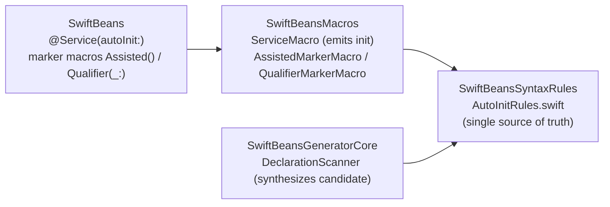

# Service auto-init — architecture

## Authority and scope

- Design: [DESIGN.md](../../design/service-auto-init/DESIGN.md), approved in chat 2026-11-20.
- Specification: [SPEC.md](SPEC.md), approved in chat 2026-11-20, with a Phase 2 amendment
	(diagnostics reported once) approved with this document on 2026-11-20.
- Architecture: Phase 2 approved in chat on 2026-11-20.

The signatures below are contracts for Phases 3–4. Exact private helper names can change, but these
seams cannot change without returning here. Source indentation stays tabs.

## Module map



| Target | Change |
|---|---|
| `SwiftBeans` | `Macros.swift`: `autoInit: Bool = false` on the four `@Service` overloads, `names: named(init)`, two marker macro declarations and doc comments |
| `SwiftBeansSyntaxRules` | New `AutoInitRules.swift`. `serviceViolations` gains the `service.autoInit` check. New `propertyMarkerViolations` |
| `SwiftBeansMacros` | `ServiceMacro` emits the init. New `MarkerMacros.swift`, registered in `SwiftBeansMacrosPlugin` |
| `SwiftBeansGeneratorCore` | `DeclarationScanner` adds the synthesized initializer and drops invalid auto-init services. `assistedPropertyLocations` / `qualifierPropertyLocations` and their `ProviderResolver` errors are removed |
| Plugin, generator CLI, runtime registry | Unchanged |

## `SwiftBeansSyntaxRules` contracts (`AutoInitRules.swift`)

```swift
/// One generated-init parameter, derived from one stored-property binding.
public struct AutoInitParameter {
	/// The property identifier: both the label and the internal name.
	public var name: TokenSyntax
	/// The property's type as written (trimmed).
	public var type: TypeSyntax
	/// The binding, for generator diagnostics (missing dependency, `qualifier.assisted`).
	public var binding: PatternBindingSyntax
	/// `var x: T?` / `Optional<T>` without a value; rendered `= nil`.
	public var defaultsToNil: Bool
	/// A syntactic function type (possibly attributed or parenthesized); rendered with `@escaping`.
	public var isEscapingFunction: Bool
	/// The property's `@Assisted` / `@Qualifier(…)` attributes, copied onto the parameter.
	public var assisted: AttributeSyntax?
	public var qualifier: AttributeSyntax?
}

public struct AutoInitModel {
	/// `public` (for `public`/`open`), `package`, or `nil` for no modifier.
	public var accessModifier: Keyword?
	public var parameters: [AutoInitParameter]
	/// The emitted declaration, rendered from the fields above. The macro returns it, and the generator
	/// reads its signature.
	public var initializer: InitializerDeclSyntax { get }
}

extension SwiftBeansSyntaxRules {
	/// `false` when `autoInit:` is absent. `service.autoInit` when it is not a Boolean literal.
	public static func autoInit(of attribute: AttributeSyntax) -> Result<Bool, Violation>

	/// Inclusion rules (SPEC "Generated initializer" 1–8) plus the rejected forms
	/// `autoInit.existingInit`, `autoInit.propertyAttribute`, `autoInit.pattern` and `autoInit.missingType`.
	/// It never fails with an empty array. `AutoInitViolations` wraps `[Violation]` because an array is not an `Error`.
	public static func autoInitModel(_ declaration: some DeclGroupSyntax) -> Result<AutoInitModel, AutoInitViolations>

	/// `assisted.property` / `qualifier.property` placement, plus the qualifier-name rules for `@Qualifier`.
	/// `enclosing` is the nearest lexical type: `context.lexicalContext.first` in the macro, and the
	/// visited type group in the scanner.
	public static func propertyMarkerViolations(
		_ declaration: some DeclSyntaxProtocol,
		attribute: AttributeSyntax,
		enclosing: Syntax?
	) -> [Violation]
}
```

Invariants:
- **One derivation.** Neither the macro nor the scanner decides which properties are parameters or
	how they are spelled. Both call `autoInitModel`. The macro emits `model.initializer`. The scanner
	turns `model.initializer`'s signature into `InitializerInfo` through its existing
	`initializers(in:)` / `parameters(_:)` path, then moves each parameter's `location`/`typeLocation`
	to `parameters[i].binding`, because synthesized nodes have no source position. The macro and the
	generator therefore agree by construction. Tests pin this (see "Test seams").
- **Rendering.** `@escaping` goes first in an `AttributedTypeSyntax`'s attribute list, before the
	copied attributes and after specifiers such as `sending`. A bare function type is wrapped in a new
	`AttributedTypeSyntax`. Optional and IUO types are never wrapped. The body is a `CodeBlockSyntax`
	with `self.name = name` statements and no other statements.
- **Attribute allowlist** for included properties: `ObservationIgnored`, `available` and the
	SwiftBeans markers, matched by name (bare or module-qualified: `Observation.ObservationIgnored`,
	`SwiftBeans.Assisted`). Any other attribute triggers `autoInit.propertyAttribute` at that attribute.
	Excluded properties (those with a value, or `static`/`lazy`/computed) may have any attributes.
- **Diagnostic nodes:** `autoInit.existingInit` is reported at the first body `init` keyword,
	`autoInit.pattern` at the pattern, `autoInit.missingType` at the binding and `service.autoInit` at the
	argument expression.
- **Marker placement.** A marker is valid when `declaration` is a `VariableDeclSyntax` that has no
	`static`/`class`/`lazy` modifier, every binding is stored, and `enclosing` is a class, struct or
	actor whose `@Service` attribute has `autoInit(of:) == .success(true)`. Otherwise the violation is
	at the marker attribute, with the spec's two-fix message.
- The existing `isAssisted` / `isQualifier` / `qualifierName` recognizers are reused unchanged.

## `SwiftBeans` declarations

```swift
@attached(member, names: named(init))
public macro Service(in owner: Any.Type? = nil, scope: BeanScope = .singleton, autoInit: Bool = false) = …
// The same change applies to the `named:`, `boundTo:` and `boundTo:named:` overloads.

/// Marks a stored property of an `@Service(autoInit: true)` type as a runtime argument.
/// On parameters, `@Assisted` resolves to the `Assisted` property wrapper instead.
@attached(peer)
public macro Assisted() = #externalMacro(module: "SwiftBeansMacros", type: "AssistedMarkerMacro")

/// Marks a stored property of an `@Service(autoInit: true)` type as a named dependency.
@attached(peer)
public macro Qualifier(_ name: String) = #externalMacro(module: "SwiftBeansMacros", type: "QualifierMarkerMacro")
```

The `Assisted` / `Qualifier` property wrappers are unchanged. Swift resolves a property-position
attribute to the macro and a parameter-position attribute to the wrapper. This was verified on Swift
6.4.2, the package minimum, and is pinned by the integration target below.

## `SwiftBeansMacros`

- `ServiceMacro.expansion`:
	1. Diagnose `serviceViolations`, which now includes `service.autoInit`.
	2. If `autoInit(of:)` is `.success(true)` and the declaration is a class, struct or actor, call
		`autoInitModel`. On success return `[DeclSyntax(model.initializer)]`; on failure diagnose and
		return `[]`.
	3. Otherwise return `[]`, the same as today.
- `AssistedMarkerMacro` / `QualifierMarkerMacro` are `PeerMacro`s. They diagnose
	`propertyMarkerViolations(declaration, attribute:, enclosing: context.lexicalContext.first)` and
	return `[]`. This is the same pattern as `ContextInputMacro`.
- Register both in `SwiftBeansMacrosPlugin.providingMacros`.

## `SwiftBeansGeneratorCore`

- `recordService`: add `service.autoInit` to the skipped violation IDs. When `autoInit` is true and
	`autoInitModel` fails, return without recording the service: no provider, no diagnostic.
- Type visit: when the type's `@Service` has `autoInit: true` and the model succeeds, append a
	synthesized `InitializerInfo` to `TypeDecl.initializers`:
	- `isCandidate: true`, `isInject: false`, `hasEffects: false`.
	- `isPublic` comes from `accessModifier == .public`.
	- `location` is the `autoInit:` argument, so initializer-ambiguity diagnostics point somewhere real.
	- For a struct, `memberwise`/`hasWrappedProperty` are left as computed and become unused, because a
		candidate now exists. This matches today's selection order.
- Each synthesized `ParameterInfo` is built by the scanner's existing parameter conversion:
	- `isAssisted` and `qualifier` come from the copied attributes, with `QualifierUse.location` at the
		property's attribute.
	- `hasDefault` comes from `defaultsToNil`, so the optional-dependency rule applies unchanged.
	- `qualifier.assisted` and missing-dependency errors therefore land on the property.
- `recordInitializerBodies`: the synthesized init is not added, because its body only assigns.
- Remove `ScannedFile.assistedPropertyLocations`, `ScannedFile.qualifierPropertyLocations`,
	`recordMarkerProperties` and the two `ProviderResolver.resolve` loops. In
	`specs/compile-time-di/ARCHITECTURE.md`, the "Division of labor" row for `@Assisted` on a stored
	property becomes macro-owned. Update that row in Phase 4.
- `ProviderResolver`, `GraphValidator`, `ContextGraph` and `CodeGenerator` need no changes. The
	generated context calls `Type(name: …)` exactly as it would for a hand-written init.

## Concurrency, isolation and lifetime

There are no new runtime types, and lifetimes and scopes are unchanged. The generated init has no
isolation of its own, so it inherits the type's. Generated accessors already call initializers from
the context's isolation, so behavior matches a hand-written init. The new rules are pure functions
over syntax and keep no global state.

## Test seams (Phase 3 mapping)

| Spec scenarios | Where |
|---|---|
| Expansion shapes (coordinator, markers, optional var/let, excluded members, struct, actor, access, empty), F1, F3–F5, F7, F9, F10 (no `@escaping` for a typealias, documented) | `Tests/SwiftBeansMacrosTests/AutoInitMacroTests.swift` (`assertMacroExpansion`, both `ServiceMacro` and marker macros) |
| F2, F6, F7 marker messages | Same file, plus a rule-level test in `SwiftBeansMacroDiagnosticsTests` |
| Resolution: optional dependency present/absent, optional let missing, `@Inject` across extension, `qualifier.assisted`, assisted accessor and factory, dropped invalid service, autoInit-false byte-identical output | `Tests/SwiftBeansGeneratorCoreTests/GeneratorAutoInitTests.swift` |
| Macro/generator agreement | Same file. For each fixture, the scanner's synthesized `InitializerInfo` (labels, types, defaults, markers) equals the signature of `autoInitModel(...).initializer`, re-parsed from its text. Requires adding `SwiftBeansSyntaxRules` to `SwiftBeansGeneratorCoreTests`' dependencies |
| End-to-end compile: an `@Observable @MainActor` coordinator, the assisted/qualified view model, a struct, an actor, same-name marker/wrapper resolution, `@ObservationIgnored` | New `Tests/SwiftBeansAutoInitIntegrationTests/` target with `SwiftBeansPlugin` applied, modeled on `SwiftBeansChildContextIntegrationTests`. The real macro and the real generator meet in one compiled module |
| F11 (superclass init) | README only. It is Swift's own diagnostic and has no SwiftBeans behavior to test |
| Example and docs adoption | Example `xcodebuild test` plus the macOS and iOS Simulator builds. README and doc comments are checked in review |

Package manifest changes: a new test target `SwiftBeansAutoInitIntegrationTests` (depends on
`SwiftBeans`, applies the plugin, and uses `.defaultIsolation(MainActor.self)` so its root `@MainActor` context compiles), and `SwiftBeansSyntaxRules` added to `SwiftBeansGeneratorCoreTests`.
There are no new products.

## Risks

- **Name resolution changes in a later Swift version** (the macro versus the wrapper). The integration
	target fails loudly if it changes, and the fallback is to rename the marker macros.
- **Interaction with the `@Observable` expansion.** The service macro sees pre-expansion source and
	assigns tracked `var`s through their init accessors. The integration target covers this.
